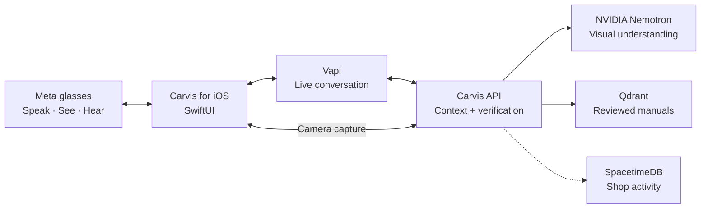

<div align="center">

# CARVIS

### Eyes on the job. Answers in your ear.

**The hands-free AI copilot for automotive technicians.**

Talk to your service manual. Inspect parts through smart glasses. Get verified answers without putting down your tools.

**Built at [HackUTD 2026](https://hackutd-zeroday.devpost.com/)**


</div>

---

## The problem

**Mechanics work with their hands. Their information lives behind screens.**

Looking up a specification means stopping the job, reaching for a device, and searching through service documentation. Asking a generic AI is faster—but an invented torque value or fluid capacity isn't an acceptable answer.

**Carvis brings the answer into the workflow, not the workflow to a screen.**

## A conversation, not another app to navigate

> **Mechanic:** “Hey Carvis. What's the rear ride-height tolerance on my WRX?”<br>
> **Carvis:** *Confirms the vehicle, finds the matching reviewed manual entry, and speaks the specification through the glasses.*<br>
> **Mechanic:** “Look at this part.”<br>
> **Carvis:** *Captures the view from the glasses and asks NVIDIA Nemotron to identify the component.*<br>
> **Mechanic:** “What about this one?”<br>
> **Carvis:** *Keeps the vehicle and repair context across the conversation.*

The primary interface is **Meta Ray-Ban glasses paired with a native SwiftUI iPhone app**—designed for occupied hands and divided attention.

## Built around three capabilities

| **SEE** | **KNOW** | **CONNECT** |
| :--- | :--- | :--- |
| **NVIDIA Nemotron** interprets fresh images from the glasses to help identify parts. | **Qdrant + source validation** retrieve vehicle-specific specifications from reviewed service manuals, with citations and refusal when evidence is missing. | **SpacetimeDB** powers shop identities, roles, invitations, and shared query history in a companion manager workspace. |

**The difference:** Carvis separates *what the camera might see* from *what the manual can prove*. The conversational AI coordinates the experience; verified source records determine technical values.

## How Carvis works



- **Hands-free by design.** Spoken activation in an armed session, natural follow-ups, voice responses, and on-demand glasses-camera capture.
- **Vehicle-aware.** Remembers confirmed vehicle details, variants, and the current task; clears stale context when the vehicle changes.
- **Evidence before answers.** Matches the exact vehicle and operation, checks reviewed source data, and preserves units and applicability conditions.
- **Built for the shop floor.** The iOS experience serves the mechanic; a separate reactive shop dashboard gives managers and teams visibility into recorded queries and sources.

## Technology

**SwiftUI + Meta Wearables SDK** · **Vapi** · **NVIDIA Nemotron** · **FastAPI / Python** · **Qdrant Cloud + FastEmbed** · **SpacetimeDB** · **React / TypeScript** · **LlamaParse**

## Run Carvis

**You'll need:** Xcode, an iPhone, compatible Meta Ray-Ban glasses, and configured service credentials.

```bash
python3 -m venv .venv
.venv/bin/pip install -r backend/requirements.txt
cp backend/.env.example backend/.env
cd backend
CARVIS_QDRANT_COLLECTION=carvis_specs_v2 ../.venv/bin/uvicorn main:app --port 8000
```

Configure your backend credentials privately, then open [`ios/Carvis/Carvis.xcodeproj`](ios/Carvis/Carvis.xcodeproj) in Xcode. Set the Meta app credentials, Vapi public key and assistant ID, and a backend HTTPS URL reachable from both the iPhone and Vapi.

**Setup and validation:** [iOS guide](ios/README.md) · [Hands-free test](docs/testing/handsfree.md) · [Source verification](docs/validation/qdrant-v2.md) · [Shop dashboard](frontend/)

---

<div align="center">

### The best interface is the one that lets you keep working.

**CARVIS · Built for the hands-on world.**

</div>
