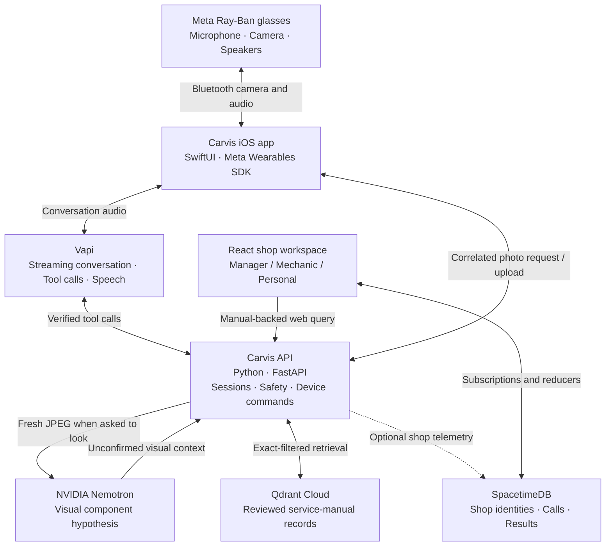

<div align="center">

# Carvis

### Eyes on the job. Answers in your ear.

**The hands-free AI copilot for automotive technicians.**

Carvis turns Meta smart glasses into a conversational repair assistant: **ask a question, show it a part, and hear an answer grounded in the right service manual**—without setting down your tools.

**Developed at [HackUTD 2026](https://hackutd-zeroday.devpost.com/), building on an existing automotive RAG backend.**


</div>

---

> **“Hey Carvis.”**<br>
> “What are we working on?”<br>
> “My 2022 WRX. What's the rear ride-height tolerance?”
>
> Carvis confirms the vehicle, searches the relevant reviewed manual data, and speaks the documented tolerance through the glasses. The mechanic keeps working.

## Why Carvis

Mechanics don't work at desks. They work under hoods, beneath vehicles, and around equipment—with their hands occupied and their attention on the machine. Yet the information they need is usually trapped in a service manual, a search result, or a phone screen.

A generic chatbot can answer quickly, but speed is not enough when a wrong fluid capacity, fastener specification, or vehicle variant matters. A camera model can recognize a part, but recognizing it is not the same as knowing its service specification.

**Carvis brings the interface to the mechanic and keeps technical authority with the manual.** It combines spoken conversation, first-person visual context, exact vehicle filtering, and evidence-checked retrieval. For teams, it adds a shared shop workspace so useful work records aren't isolated to one person.

## How it works

1. **Listen.** With Carvis armed on the iPhone and the Meta glasses connected, the mechanic says **“Hey Carvis”** or **“Hi Carvis.”** Carvis transitions from wake recognition into a real-time voice conversation through Vapi.
2. **Remember.** The mechanic confirms the vehicle once. Carvis tracks the confirmed year, model, transmission and other relevant variants, plus the current job, so follow-ups keep their context. A correction invalidates answers tied to the previous vehicle or component.
3. **Look.** On **“Look at this,”** Carvis requests a fresh photo from the glasses. **NVIDIA Nemotron** analyzes the image and proposes a component identity. The observation is treated as a hypothesis—not as a verified repair fact.
4. **Verify.** For a technical question, Carvis queries **Qdrant** for the matching service-manual record. The Python backend checks vehicle applicability, operation, units, source excerpts, reviewer status, and conflicting evidence before authorizing a spoken value.
5. **Speak.** Vapi delivers a concise answer through the glasses. When the documentation is missing, ambiguous, or unreviewed, Carvis asks for clarification or says it cannot verify the specification. It doesn't invent a number to fill the silence.
6. **Connect.** The **SpacetimeDB**-backed web workspace supports shop identities, invitations, permission-scoped query records, citations, and reactive updates for a connected team.

### A repair conversation, not a search box

> **Mechanic:** “Hey Carvis.”<br>
> **Carvis:** “What are we working on?”<br>
> **Mechanic:** “The WRX. What's the oil capacity with the filter?”<br>
> **Carvis:** *Retrieves the verified value for the confirmed vehicle and transmission.*<br>
> **Mechanic:** “And without the filter?”<br>
> **Carvis:** *Keeps the vehicle context, changes the operation, and checks the manual again.*<br>
> **Mechanic:** “Look at this part.”<br>
> **Carvis:** *Captures a new glasses image and identifies what it may be.*

## Features

The native iOS app is Carvis's primary product interface. The web workspace is retained supporting code and is not used in the current glasses demonstration.

- **Hands-free voice interface.** Wake-phrase recognition, conversational follow-ups, audio routing checks, and spoken responses over connected Meta glasses.
- **First-person visual inspection.** A voice-triggered camera request bridges Vapi's server-side tool call to a real iPhone/glasses capture; NVIDIA Nemotron supplies the visual interpretation.
- **Vehicle-aware memory.** Confirmed year, make, model, transmission, wheel size, active component and operation stay associated with the conversation. Corrections clear stale context.
- **Source-grounded technical answers.** Qdrant retrieves structured, reviewed manual records; Python validates exact applicability and evidence before formatting technical numbers for speech.
- **Refusal instead of guesswork.** Unsupported wheel torque, conflicting variants, unverified OCR, and missing source material don't become confident-sounding answers.
- **Manual ingestion with provenance.** LlamaParse-assisted extraction, content-hash caching, structured records, source-page/table/row references, explicit review status, and duplicate-safe writes.
- **Connected shop workspace.** SpacetimeDB supports manager, mechanic, and personal roles; shops, memberships, invitations, and shared web query history with citations and latency metadata.
- **Native iPhone experience.** The SwiftUI app provides the mechanic's interface and glasses integration. The existing React workspace is preserved for shop administration and development, outside the current demo.

## One product, three track perspectives

### NVIDIA: visual understanding inside a tool-using workflow

Nemotron is Carvis's default visual provider. A fresh glasses image becomes a component hypothesis with visual context and uncertainty. The conversational assistant can coordinate vehicle confirmation, camera capture, visual interpretation, and manual lookup across separate tools. Nemotron handles perception; the Vapi conversational model handles dialogue and tool selection; reviewed manual evidence supplies technical values.

The demonstrated ride-height lookup does not itself prove visual reasoning: a complete specification question can bypass Nemotron. Visual inspection is a separate implemented capability, with backend inference tested and the full voice-triggered camera path requiring its own physical-device validation.

### SpacetimeDB: from one mechanic to a connected shop

SpacetimeDB stores profiles, shops, invitations, query records and results, with role-scoped views and reactive web subscriptions. Qdrant remains the manual evidence store. This separates technical knowledge from shared shop activity and provides a foundation for multiple mechanics and shops.

Queries carry vehicle year, make and model, but a shared fleet-management entity is not implemented. The schema and subscriptions are a foundation for expansion, not evidence of load-tested scale or complete native-app synchronization.

### Design: attention stays on the vehicle

The mechanic's interface prioritizes occupied hands and divided attention: voice activation during an armed session, concise spoken answers, retained vehicle context, and visible listening, processing and failure states. The web workspace serves a different task: reviewing evidence and organizing shop membership and activity. The aim is to make the right information accessible without turning the repair into a screen-based conversation.

## Demonstrated, implemented, and next

| Capability | Evidence and scope |
| --- | --- |
| Spoken ride-height tolerance question and response through physical glasses | Team-reported completed demo |
| Glasses connection, preview, JPEG capture and image-to-answer path | Previously demonstrated; does not establish camera/audio concurrency in a Vapi call |
| Nemotron visual component interpretation | Backend integration tested; live voice-triggered inspection needs separate hardware evidence |
| Correlated camera tools, vehicle context and conversation lifecycle | Implemented; physical recovery, interruption and routing checks require device tests |
| Exact applicability, evidence checks, deterministic numeric formatting and refusal | Backend regression-tested; not a guarantee against every unsupported conversational claim |
| SpacetimeDB roles, shops, invitations and reactive web query records | Implemented and type-checked; multi-user deployment requires its own live validation |

Near-term expansion includes more reviewed manuals, shared vehicle records, durable conversation state, native shop synchronization and validated inspection workflows. These are future work, not demonstrated autonomous repair capabilities. The event work extends an existing backend; it is not a claim that every component was created from scratch in 24 hours.

## Architecture



### Each system has one job

| Layer | Technology | Responsibility |
| --- | --- | --- |
| Wearable interface | Ray-Ban Meta glasses, Meta Wearables Device Access Toolkit | First-person camera, microphone, speaker route and wake-listening capability |
| Mobile companion | Swift, SwiftUI, AVFoundation | Conversation lifecycle, permissions, Bluetooth routing, vehicle profile, camera capture |
| Voice orchestration | Vapi, streaming ASR/TTS, conversational LLM | Turn-taking, interruptions, spoken dialogue, and tool selection |
| Visual perception | **NVIDIA Nemotron** | Interpret a new image and propose what component is visible |
| Technical knowledge | **Qdrant Cloud**, FastEmbed | Retrieve relevant, vehicle-specific manual records |
| Trust and orchestration | **Python, FastAPI, Pydantic** | Authorize specification values, handle corrections, correlate camera requests and manage sessions |
| Shop collaboration | **SpacetimeDB** | Role-scoped shop identity, invitations, query history, result metadata, reactive subscriptions |
| Shop dashboard | **React, TypeScript, Vite** | Web query workflow, evidence display, team membership and shared activity |
| Document processing | **LlamaParse** + Carvis review pipeline | Extract, normalize, stage and verify source-manual information |

**The distinction matters:** Nemotron helps Carvis *see*; Qdrant finds what the *manual says*; Carvis's deterministic verification decides what technical values can be *spoken*. SpacetimeDB manages *people and shared shop activity*—it is not the manual vector store.

## Grounding: a technical answer has to earn its way out

A service-manual record carries the vehicle and relevant variants, component, operation, specification type, exact value and unit, source file/page/table/row, source text, document hash and verification status.

Before a numerical answer is returned, the backend:

1. Requires a confirmed vehicle and resolves the specific part, operation, and necessary variants.
2. Filters the candidate records by exact fields and **verified** status.
3. Checks applicability, source evidence, review digest, conflicting values and manual revisions.
4. Formats the approved result deterministically and attaches source citations.
5. Requests clarification or refuses when those conditions are not met.

A visual guess **never** overrides the vehicle on file or turns an unreviewed value into a valid specification. Verified manual coverage is intentionally limited; it is not a claim that Carvis knows every vehicle or procedure.

## The connected shop

Carvis extends beyond an individual mechanic with a role-aware web workspace built around SpacetimeDB.

| Role | Experience |
| --- | --- |
| **Shop manager** | Create a shop, invite mechanics, manage membership, and review shop-scoped query records |
| **Mechanic** | Join a shop by invite/code and access shared shop calls and their documented results |
| **Personal user** | Use the manual-query interface without access to shop-only records |

The React client subscribes to SpacetimeDB views for member lists, invitations, calls and results. The browser's query workflow records question/result metadata for the shop. The FastAPI backend also contains optional best-effort SpacetimeDB telemetry hooks.

The **native iOS shop-floor crew screen is currently a simulated interface**, separate from the live web workspace. Conversation memory itself lives in the FastAPI process; SpacetimeDB is not yet a durable store for every voice turn.

## Getting started

### Requirements

- Python 3.12 recommended, Node.js and npm, plus the dependencies in `backend/requirements.txt` and `frontend/package.json`.
- A Qdrant database containing reviewed Carvis v2 records.
- NVIDIA API access for live visual understanding; Llama Cloud credentials if ingesting more manuals.
- For the wearable app: a Mac with Xcode, a physical iPhone, paired compatible Meta glasses, and Meta Wearables developer registration.
- For live voice calls: Vapi keys, a configured assistant, and a public HTTPS backend URL that Vapi can reach.
- For connected-shop features: a published SpacetimeDB module and matching web configuration.

### 1. Start the backend

```bash
git clone https://github.com/tejaspalukuri/HackUTD26.git
cd HackUTD26

python3 -m venv .venv
.venv/bin/pip install -r backend/requirements.txt
cp backend/.env.example backend/.env
# Fill in backend/.env with server-side credentials.

# Use a reviewed collection; the legacy collection intentionally refuses new spec lookups.
cd backend
CARVIS_QDRANT_COLLECTION=carvis_specs_v2 ../.venv/bin/uvicorn main:app \
  --host 0.0.0.0 --port 8000
```

`backend/.env` supplies `QDRANT_URL`, `QDRANT_API_KEY`, `NVIDIA_API_KEY` and `VAPI_WEBHOOK_SECRET`; `LLAMA_CLOUD_API_KEY` is for new document ingestion. For a deployed service, set `CARVIS_QDRANT_COLLECTION` in the host's environment. Do not switch to an unvalidated collection simply to make queries return data.

### 2. Optional: run the retained web workspace

This workspace is not required to build the iOS app or run the glasses voice workflow.

In another terminal:

```bash
npm ci --prefix frontend
npm run dev --prefix frontend
```

The Vite app uses `VITE_CARVIS_API_URL` for the FastAPI endpoint (or its `/api` dev proxy). For the connected-shop experience, configure `VITE_SPACETIMEDB_URI`, `VITE_SPACETIMEDB_DB_NAME`, and—if using the hosted auth flow—`VITE_SPACETIMEAUTH_CLIENT_ID`. The SpacetimeDB TypeScript module is in `carvis-module/spacetimedb/` and uses the `spacetime` CLI for its build/publish scripts.

### 3. Configure Vapi and the glasses

Use a public HTTPS URL for the backend: Vapi cannot reach a laptop-only `.local` address.

```bash
# From the repository root, after setting VAPI_PRIVATE_KEY and
# VAPI_WEBHOOK_SECRET in backend/.env:
.venv/bin/python backend/vapi_assistant.py --public-url https://YOUR-BACKEND
```

To update an existing assistant rather than create another, set `VAPI_ASSISTANT_ID` in `backend/.env` first. The configured Vapi tools include `confirm_vehicle`, `set_work_context`, `lookup_spec`, and `look_at_part`.

In `ios/Carvis/Carvis/Config/`, copy `VapiConfig.example.plist` to the git-ignored `VapiConfig.plist` and add the **Vapi public key** and **Assistant ID**. Open `ios/Carvis/Carvis.xcodeproj` in Xcode, supply your Meta App ID and Client Token, select your signing team, and run Carvis on the paired iPhone.

See [iOS setup](ios/README.md), [wake-phrase checks](docs/testing/wake-listener.md), and [the complete hands-free hardware test](docs/testing/handsfree.md). Device permission and audio-route verification are essential; an automated test cannot prove the glasses are actually carrying the audio.

## Configuration

| Setting | Where | Purpose |
| --- | --- | --- |
| `QDRANT_URL`, `QDRANT_API_KEY` | Backend environment | Connect to the existing manual collection |
| `CARVIS_QDRANT_COLLECTION` | Backend environment | Select the validated v2 collection/alias |
| `NVIDIA_API_KEY`, `NEMOTRON_MODEL` | Backend environment | Enable Nemotron image analysis |
| `VAPI_WEBHOOK_SECRET` | Backend environment | Authenticate Vapi tool callbacks |
| `VAPI_PRIVATE_KEY`, `VAPI_ASSISTANT_ID` | Backend local setup | Create or update the Vapi assistant |
| Vapi `PublicKey`, `AssistantID` | Local iOS `VapiConfig.plist` | Start conversations from the iPhone |
| Meta App ID, Client Token | Local iOS Meta configuration | Register and authorize glasses access |
| `LLAMA_CLOUD_API_KEY` | Backend environment | Parse and stage additional manuals |
| `SPACETIMEDB_URI`, `SPACETIMEDB_DB_NAME`, `SPACETIMEDB_TOKEN` | Backend environment, optional | Best-effort shop telemetry |
| `VITE_SPACETIMEDB_URI`, `VITE_SPACETIMEDB_DB_NAME` | Web build environment | Connect the shop dashboard |

**Never commit private keys, raw manuals, source-review exports, captured images, or local device logs.** The iOS app needs only Vapi's public client key, not server-side service secrets.

## Project layout

```text
backend/          FastAPI, conversation state, Vapi tools, Nemotron adapter,
                  Qdrant retrieval, PDF ingestion, source verification, tests
  conversation.py    Correlated voice sessions, vehicle context, camera requests
  vapi_assistant.py  Reproducible Vapi assistant/tool setup
  spec_retrieval.py  Exact-filtered, evidence-checked technical answers
  ingest.py          Manual ingestion and staging
carvis-module/
  spacetimedb/     Shop profiles, roles, invites, calls and results module
frontend/         Retained web workspace; not required by the native glasses demo
ios/
  Carvis/         SwiftUI iPhone app, Meta glasses, Vapi, camera, Bluetooth
  README.md       Native setup and signing instructions
docs/             Architecture, source validation, and database migration runbooks
  testing/        Backend demo, hands-free acceptance, and wake diagnostics
  validation/     Recorded source-review and Qdrant acceptance evidence
render.yaml       Example backend deployment blueprint
```

### Documentation

| Guide | Purpose |
| --- | --- |
| [iOS setup](ios/README.md) | Native app configuration, SDK setup and signing |
| [Hardware acceptance](docs/testing/handsfree.md) | Physical-device verification and recovery checks |
| [Wake diagnostics](docs/testing/wake-listener.md) | Focused wake-listener troubleshooting |
| [Architecture](docs/architecture.md) | Backend contracts and retrieval design |
| [Qdrant migration](docs/qdrant-v2-migration.md) | Source review, collection configuration, activation and rollback |
| [Source validation](docs/validation/qdrant-v2.md) | Recorded manual evidence and acceptance results |
| [Backend demo checks](docs/testing/backend-demo.md) | Reviewed specification examples and refusal checks |

Runtime source, public API routes, database modules, project paths and deployment entry points are preserved. Obsolete implementation plans are omitted; operational guides and the Vapi runtime prompt remain in place.

## Development and testing

```bash
.venv/bin/python -m pytest backend/tests -q
npm run build --prefix frontend
```

Local validation on November 8, 2026 passed **113 backend tests**, **66 conversation-rule checks**, **29 wake-phrase checks**, the frontend production build and the SpacetimeDB module TypeScript check. The team also reported physical-glasses demonstrations of connection, camera capture and a spoken, source-backed ride-height question. Those test counts are software validation—not a statistical claim about recognition accuracy on hardware. Full audio, photo-in-call, interruption and locked-screen behavior should be reported from their respective physical runs, not inferred from mocks. A full Xcode build was unavailable on the auditing Mac.

For manual review and database migration guidance, see [Qdrant v2 validation](docs/validation/qdrant-v2.md) and [migration instructions](docs/qdrant-v2-migration.md).

## Limitations and design boundaries

- **Verified coverage is narrower than the automotive world.** Unreviewed OCR rows and missing manual pages are not authorized to supply repair values. Some specifications, including previously requested wheel-nut torque, may correctly return a refusal.
- **Vision is a hypothesis.** Nemotron can misidentify a part; Carvis asks for confirmation before using the observation as a technical fact.
- **The custom wake phrase needs an armed session.** “Hey Carvis” is not a replacement for Meta's system-wide wake word and is not guaranteed to launch a terminated app. Locked-phone/background behavior is a separate device test.
- **Speech needs working glasses audio routing.** The app is designed to pause rather than silently switch a hands-free conversation to the iPhone microphone or speaker.
- **Connected-shop scope is specific.** The SpacetimeDB web workspace manages users and recorded queries; the native iOS shop-crew display is simulated, and conversational memory is currently in-process.
- **The step guide remains scripted.** `RepairSession` defaults to `MockBackendClient`, whose oil-change instructions and tool traces are predefined. This guide is separate from live specification retrieval and must not be presented as source-verified agent execution.
- **Grounding is not a universal zero-hallucination guarantee.** Verified lookup values are checked deterministically, but ordinary model-generated dialogue is still constrained primarily by the assistant prompt.
- **Cloud connectivity matters.** Vapi, NVIDIA inference and remote retrieval require network access; latency depends on the cellular connection and hosting environment.
- **This is a copilot, not a substitute for a technician or the official manual.** Follow appropriate shop safety practices and verify safety-critical steps against applicable manufacturer documentation.

## Team

Built for **HackUTD 2026**. See the [project contributors](https://github.com/tejaspalukuri/HackUTD26/graphs/contributors).

---

<div align="center">

**Eyes on the job. Answers in your ear.**

</div>
