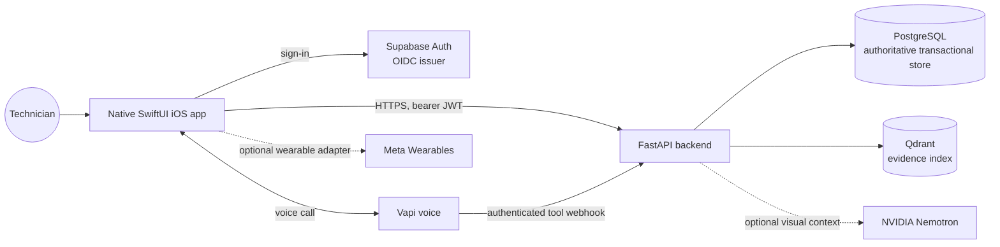

# CARVIS

**Conversational Automotive Repair & Visual Intelligence System**

CARVIS is a native iOS assistant that gives professional automotive technicians vehicle-specific,
source-grounded repair information by voice, without stepping away from the vehicle.

## The problem

Technicians regularly stop physical repair work to look up information that already exists in
service-information systems: they remove gloves, walk to a shop computer, navigate documentation and
interpret the result. The information exists; using it at the moment it is needed is the hard part.
CARVIS closes that gap. It augments the technician's expertise and never replaces professional
judgment.

## Product principles

- **Minimal interruption.** The technician keeps working; CARVIS fits existing shop workflows
  instead of adding administrative tasks.
- **Voice first.** The primary interaction is natural conversation through the iPhone or a connected
  headset. Wearables are optional adapters, never a prerequisite.
- **Explicit vehicle context.** Every technical answer is bound to a vehicle the technician has
  confirmed. Images and model output never establish vehicle identity.
- **Verified information or a clear refusal.** Answers come only from reviewed, applicable evidence
  with provenance. When evidence is missing, conflicting or out of scope, CARVIS says so instead of
  guessing.

The first release, **V1**, is a TestFlight field test with a pilot technician. Its scope is defined
in the [V1 Product Experience Contract](docs/product/v1-product-experience-contract.md).

## Architecture

The diagram shows the target architecture for V1, whose direction the owner approved in principle.
Each component's decision record and status (accepted or proposed) is in the table below.
Implementation is incremental; progress and dependencies are tracked in the
[M2 roadmap](docs/architecture/12-m2-roadmap.md).



| Component | Responsibility | Decision |
| --- | --- | --- |
| Native SwiftUI app (`ios/`) | The only user-facing client: voice session, Garage, history, evidence display, feedback | [PRD](docs/PRD.md) |
| FastAPI backend (`backend/`) | The single application API and policy enforcement point: authentication, tenant authorization, conversation orchestration, verification and refusals | [ADR-0002](docs/decisions/0002-identity-provider-and-token-model.md), [ADR-0004](docs/decisions/0004-api-versioning-and-error-envelope.md) (accepted) |
| PostgreSQL | The single transactional store for users, workspaces, vehicles, conversations and audit data, with forced row-level security as a second isolation layer | [ADR-0001](docs/decisions/0001-single-store-postgresql.md), [ADR-0003](docs/decisions/0003-tenancy-and-row-level-security.md) (accepted) |
| Supabase | Hosts PostgreSQL and acts only as the OIDC token issuer; the app never talks to the database | [ADR-0002](docs/decisions/0002-identity-provider-and-token-model.md) (accepted) |
| Qdrant | Evidence index for reviewed knowledge; never holds identity or transactions | [ADR-0001](docs/decisions/0001-single-store-postgresql.md) (accepted); its role as a rebuildable projection of PostgreSQL knowledge is part of the proposed Brain design below |
| CARVIS Brain | Operator-reviewed knowledge with PostgreSQL as its authority and Qdrant as a rebuildable projection, checked at serve time; whether a discovery layer beyond exact retrieval is adopted is decided by benchmark | [ADR-0006](docs/decisions/0006-brain-ownership-and-restore-safety.md), [ADR-0010](docs/decisions/0010-brain-knowledge-model-and-retrieval.md) (proposed) |
| Vapi | Conversational voice transport; it calls FastAPI tools and is never an authority for tenant, vehicle or facts | [PRD](docs/PRD.md); webhook authentication and call binding in [ADR-0005](docs/decisions/0005-vapi-ingress-and-call-binding.md) (proposed) |
| NVIDIA Nemotron, Meta Wearables | Optional visual context and an optional wearable adapter; neither is a V1 prerequisite or a source of repair facts | [PRD](docs/PRD.md) |

The repository also contains a SpacetimeDB module (`backend/spacetimedb/`). Today it receives only
best-effort telemetry, and the target design does not depend on it; its retirement is proposed in
[ADR-0007](docs/decisions/0007-retire-spacetimedb.md) and not yet decided. The full design, with trust boundaries and
flows, is in [`docs/architecture/`](docs/architecture/README.md).

## Knowledge safety

CARVIS treats retrieval and verification as separate responsibilities. A technical answer must:

1. use an explicit, confirmed vehicle and relevant configuration;
2. match reviewed evidence with exact applicability and provenance;
3. preserve units, conditions, warnings, and ordered procedure stages; and
4. refuse pending, incomplete, conflicting, stale, or cross-vehicle evidence.

Semantic similarity may rank already-applicable evidence; it never proves correctness. Images and
vision models cannot establish vehicle identity or authorize repair specifications. New ingestion
is staged as pending review, and Qdrant migration or alias work must follow the
[migration runbook](docs/backend/qdrant-v2-migration.md).

## Repository layout

- `ios/` — SwiftUI application, voice experience, device integrations, and native tests.
- `backend/` — FastAPI APIs, conversation orchestration, ingestion, retrieval, verification,
  database migrations, and provider adapters.
- `backend/spacetimedb/` — SpacetimeDB module that currently receives best-effort telemetry (see above).
- `docs/` — product requirements, architecture and decision records, roadmap, runbooks, and
  archived records.
- `scripts/` — repository verification, worktree bootstrap, and review tooling.

CARVIS has no web frontend.

## Development setup

### Backend

Requirements: Python 3.12 and a safely configured local or cloud Qdrant collection.

```bash
python3.12 -m venv .venv
.venv/bin/python -m pip install --require-hashes -r backend/requirements-dev.txt
cd backend
CARVIS_ENV=local ../.venv/bin/uvicorn main:app --host 0.0.0.0 --port 8000
```

Dependencies are pinned with hashes. `backend/requirements.in` lists the direct runtime
dependencies and compiles to `backend/requirements.txt`, which is what Render installs.
`backend/requirements-dev.in` adds test tooling such as pytest and compiles to
`backend/requirements-dev.txt`, which is used for local development and CI. Edit only the `.in`
files, then regenerate both lockfiles with [uv](https://docs.astral.sh/uv/):

```bash
cd backend
uv pip compile requirements.in --universal --python-version 3.12 --generate-hashes --no-header -o requirements.txt
uv pip compile requirements-dev.in --universal --python-version 3.12 --generate-hashes --no-header -o requirements-dev.txt
```

Add `--upgrade` (or `--upgrade-package <name>`) to move pins forward deliberately.
`backend/tests/test_dependency_lock.py` fails in any of these cases:

- a lockfile entry is unpinned or unhashed;
- an input is missing from its lockfile, or is pinned outside its `.in` bound;
- test tooling reaches the runtime lockfile.

`scripts/check-runtime-lock.sh [python]` runs in CI and needs PyPI access. It:

- installs only `backend/requirements.txt` into a temporary virtual environment, as Render does;
- confirms that pytest is absent;
- imports every top-level `backend/*.py` module with `.env` loading disabled, and fails if any
  environment variable appears;
- fails on any Python-level network event (DNS lookup, connect, send, urllib request) or process
  launch during import, even one whose error a module catches;
- fails if import leaves extra threads running.

Native code that bypasses Python's `socket` module is not covered.

Keep provider credentials in the local `backend/.env`; never commit secrets, source manuals,
captured images, parse caches, Qdrant data, or review exports.

The `.env` loader, environment variables and startup guards, request limits, logging, PostgreSQL
migrations and readiness, the runtime database login and authentication settings are documented in
the [backend configuration reference](docs/backend/configuration.md).

### iOS

Open [`ios/Carvis/Carvis.xcodeproj`](ios/Carvis/Carvis.xcodeproj) in Xcode, configure signing and
`CarvisBaseURL`, then run on an iPhone or simulator. Meta Wearables support is optional and requires
the official Device Access Toolkit configuration described in the [iOS guide](docs/ios/README.md).

## Verification

In a fresh checkout, run `scripts/bootstrap-worktree.sh` to install the Python and SpacetimeDB
package dependencies (`--check` validates without installing), then run:

```bash
./scripts/verify.sh
```

The verifier runs backend regression tests, Python compilation, pure Swift conversation and wake
checks, SpacetimeDB type-checking, Apple configuration lint, repository structure checks,
documentation-link validation, and an iOS simulator build when full Xcode is available.

## Contributing

Read [`AGENTS.md`](AGENTS.md) (engineering policy, with scoped extensions under `backend/`,
`backend/spacetimedb/` and `ios/`) and the [development workflow](docs/development-workflow.md)
(branches, review tiers, required checks and draft pull requests) before changing anything.

## Documentation

Start with the [documentation map](docs/README.md), which defines precedence and a reading path.

- [Product requirements (PRD)](docs/PRD.md)
- [V1 Product Experience Contract](docs/product/v1-product-experience-contract.md)
- [Product Experience Blueprint](docs/product/carvis-product-experience-blueprint.md) (non-authoritative long-term vision)
- [V1 architecture](docs/architecture/README.md) and [decision records](docs/decisions/README.md)
- [M2 roadmap and owner decisions](docs/architecture/12-m2-roadmap.md)
- [Development workflow](docs/development-workflow.md)
- [Current backend architecture](docs/backend/architecture.md) and
  [configuration reference](docs/backend/configuration.md)
- [Qdrant review and migration](docs/backend/qdrant-v2-migration.md)
- [Native iOS setup and testing](docs/ios/README.md)
- [Historical audits](docs/audits/) and [archived records](docs/archive/)
