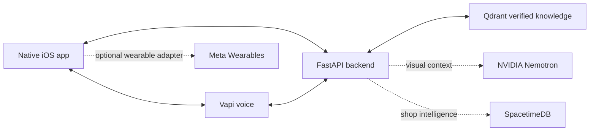

# CARVIS

CARVIS is a native iOS automotive intelligence platform for delivering vehicle-specific,
source-grounded repair information through conversational voice and optional visual context.

The system is designed for professional technicians: it preserves explicit vehicle context,
validates technical evidence deterministically, and refuses unsupported specifications rather than
guessing.

## Architecture



- `ios/` — SwiftUI application, voice experience, device integrations, and native tests.
- `backend/` — FastAPI APIs, conversation orchestration, ingestion, retrieval, verification, and
  provider adapters.
- `backend/spacetimedb/` — server-side shop/workspace schema, views, reducers, and authorization.
- `docs/` — product requirements, active architecture, operational runbooks, and archived records.

The iOS application is the only user-facing client. Carvis has no web frontend.

## Knowledge safety

CARVIS treats retrieval and verification as separate responsibilities. A technical answer must:

1. use an explicit, confirmed vehicle and relevant configuration;
2. match reviewed evidence with exact applicability and provenance;
3. preserve units, conditions, warnings, and ordered procedure stages; and
4. refuse pending, incomplete, conflicting, stale, or cross-vehicle evidence.

Semantic similarity may rank already-applicable evidence; it never proves correctness. Images and
vision models cannot establish vehicle identity or authorize repair specifications. New ingestion
is staged as pending review, and Qdrant migration or alias work must follow the
[migration runbook](docs/backend/qdrant-v2-migration.md).

## Development setup

### Backend

Requirements: Python 3.12 and a safely configured local or cloud Qdrant collection.

```bash
python3.12 -m venv .venv
.venv/bin/pip install -r backend/requirements.txt
cd backend
../.venv/bin/uvicorn main:app --host 0.0.0.0 --port 8000
```

Keep provider credentials in the local `backend/.env`; never commit secrets, source manuals,
captured images, parse caches, Qdrant data, or review exports.

### iOS

Open [`ios/Carvis/Carvis.xcodeproj`](ios/Carvis/Carvis.xcodeproj) in Xcode, configure signing and
`CarvisBaseURL`, then run on an iPhone or simulator. Meta Wearables support is optional and requires
the official Device Access Toolkit configuration described in the [iOS guide](docs/ios/README.md).

## Verification

Install Python and SpacetimeDB package dependencies, then run:

```bash
./scripts/verify.sh
```

The verifier runs backend regression tests, Python compilation, pure Swift conversation and wake
checks, SpacetimeDB type-checking, Apple configuration lint, repository structure checks,
documentation-link validation, and an iOS simulator build when full Xcode is available.

## Documentation

- [Documentation map and precedence](docs/README.md)
- [Product requirements](docs/PRD.md)
- [V1 Product Experience Contract](docs/product/v1-product-experience-contract.md)
- [P0 Readiness Audit, 2026-11-15 (historical snapshot)](docs/audits/2026-11-15-p0-readiness-audit.md)
- [Development workflow](docs/development-workflow.md)
- [Architecture decision records](docs/decisions/README.md)
- [Backend architecture](docs/backend/architecture.md)
- [Qdrant review and migration](docs/backend/qdrant-v2-migration.md)
- [Native iOS setup and testing](docs/ios/README.md)
- [Historical architecture and validation records](docs/archive/)

Engineering policy is defined in [`AGENTS.md`](AGENTS.md), with scoped extensions under `backend/`
and `ios/`.
