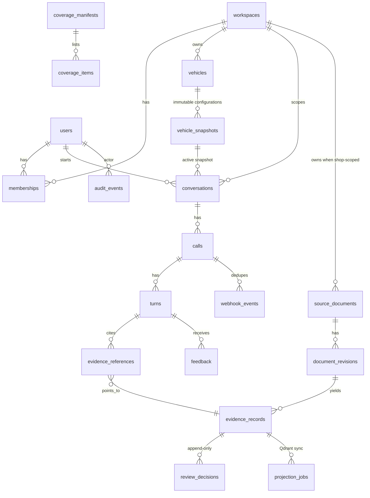

# 03 — V1 data model

Canonical store: PostgreSQL. Conventions: UUID v7 primary keys, `timestamptz` for every timestamp,
every tenant-owned table has `workspace_id NOT NULL`, every enum is a `CHECK` constraint or native
enum, foreign keys are `ON DELETE RESTRICT` unless a retention rule below says otherwise.

## ER diagram

## Field dictionary

| Table | Key fields and constraints | Mutability and retention |
| --- | --- | --- |
| `users` | `(auth_issuer, auth_subject)` UNIQUE (the verified principal, ADR-0002), `email`, `display_name`, `status` (active, deleting, deleted) | Soft-delete then purge after a grace period (proposed 30 days) |
| `workspaces` | `kind` (personal, shop), `name`, `personal_owner_user_id` (set if and only if `kind = 'personal'`, `UNIQUE`): one personal workspace per user | Removed with its owner; a shop with other members requires ownership transfer or refuses deletion |
| `memberships` | `(workspace_id, user_id)` UNIQUE, `role` (owner, admin, member) | Every workspace has an owner. B2b-1 (owner decision, 2026-11-24): no database owner-presence trigger yet. The invariant holds through the only mutation surface: `ensure_principal` creates or reuses a personal workspace and its owner membership atomically, a trigger keeps a personal workspace's only member its owner, and no runtime role can create a shop workspace or update or delete a membership or workspace. The owner-presence trigger is **mandatory in the first package that introduces shop-workspace creation, membership UPDATE or DELETE, or ownership transfer**, before those mutations are exposed |
| `vehicles` | `vin` (17 chars, `CHECK` no I/O/Q; check digit validated in application), `(workspace_id, vin)` UNIQUE where VIN present, year, make, model, trim, engine, transmission, wheel_size, `archived_at` | Editable; edits never alter past snapshots |
| `vehicle_snapshots` | `vehicle_id`, `config` jsonb, `config_hash`, `source` (vin_decode, manual), `confirmed_by`, `confirmed_at`, `schema_version` | **Immutable** (UPDATE/DELETE blocked by trigger and grants) |
| `conversations` | `user_id`, `active_snapshot_id`, `title`, `last_activity_at` | Per retention decision (ADR-0009) |
| `calls` | `conversation_id`, `generation` (UNIQUE with conversation), `vapi_call_id` UNIQUE NULL, `status` (created, bound, active, ended, failed), `bind_nonce_hash`, `bind_expires_at`, `bound_at`, `verified_with_vapi_at`, `end_reason`, `idempotency_key` UNIQUE per user | Metadata retained; no raw audio stored |
| `turns` | `call_id`, `seq` UNIQUE with call, `question_text`, `answer_text`, `outcome` (answered, refused, clarification, error), `refusal_reason`, `tool_call_id` UNIQUE, `latency_ms` | Full text 90 days, then text nulled and metadata kept (proposed) |
| `evidence_references` | `turn_id`, `evidence_id`, `revision_id`, `page`, `excerpt_sha256`, `conditions` jsonb | Kept with the turn; withdrawn evidence renders "source withdrawn" |
| `feedback` | `turn_id`, `user_id`, `kind` (incorrect, unhelpful, missing), `note`, `status` | User-deletable |
| `source_documents` | `scope` (global, workspace), `workspace_id` NULL iff global (`CHECK`), `title`, `rights_basis` (required before activation), `provenance`, `created_by` | Operator-only |
| `document_revisions` | `document_id`, `sha256` UNIQUE per document, `storage_uri`, `parser_version`, `revision_label` | Immutable |
| `evidence_records` | `revision_id`, applicability fields (year, make, model, engine, trim, transmission, market, wheel_size), `component`, `operation`, `spec_type`, `payload_digest`, `qdrant_point_id`, `state` (pending, verified, withdrawn, quarantined), `state_version`, `withdraw_reason` | State changes only through `review_decisions` (trigger-enforced) |
| `review_decisions` | `evidence_id`, `decision` (verify, reject, withdraw, quarantine, reapprove), `reason`, `reviewer_user_id`, `digest`, `source_confirmed`, `created_at` | **Append-only** |
| `projection_jobs` | `evidence_id`, `action`, `target_state_version`, `status`, `attempts`, `next_run_at`, `locked_by` | Purged 30 days after completion |
| `coverage_manifests`, `coverage_items` | scope, vehicle/component matrix, `version`, `status` | Versioned |
| `webhook_events` | `(vapi_call_id, event_key)` UNIQUE, `response_hash`, `received_at` | Purged after 14 days |
| `jobs` | `kind`, `status`, `attempts`, `next_run_at`, `workspace_id` NULL for maintenance, `payload`, `locked_by` | Purged 30 days after completion |
| `system_meta` | singleton: `decision_seq`, `brain_mode` | Updated in the same transaction as each Brain decision |
| `usage_events`, `audit_events` | actor, workspace, action, target, request_id; no transcripts or PII payloads | `audit_events` **append-only** (UPDATE/DELETE revoked), kept 1 year |

## Indexes

Indexes on tenant tables lead with `workspace_id`: conversations `(workspace_id, last_activity_at DESC)`,
turns `(call_id, seq)`, vehicles `(workspace_id, archived_at)`, feedback `(workspace_id, created_at)`.
`evidence_records` carries btree indexes on the applicability fields that mirror the Qdrant keyword
indexes in `backend/qdrant_v2.py`. Every table with `workspace_id` has RLS enabled and forced
([04-identity-tenancy-rls.md](04-identity-tenancy-rls.md)).

## Immutability rules

`vehicle_snapshots`, `document_revisions`, `review_decisions`, `audit_events` reject UPDATE and DELETE
for every application role; the tests in [10-threat-model-and-tests.md](10-threat-model-and-tests.md)
assert this through the application role, not only through the owner.

## Ownership and deletion

A user's personal workspace and everything beneath it is deleted on account deletion after the
grace period; shop workspaces are transferred or the deletion refuses. Operator-owned global Brain
data (`source_documents` with scope `global`) is never deleted by user actions. `audit_events` are
anonymized (actor reference removed) rather than deleted.
