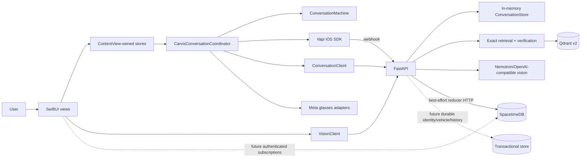
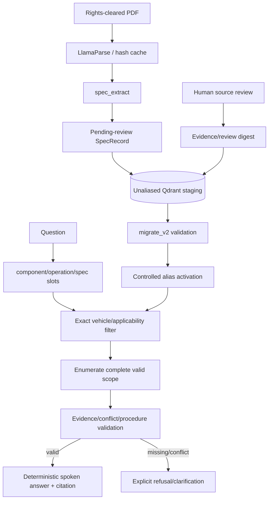

# Carvis repository architecture inventory

**Inspection date:** 2026-11-14
**Mode:** read-only inspection; this report is the only file created
**Product source:** [`PRD.md`](../PRD.md), version 1.0 draft for review

## 1. Executive structural assessment

Carvis has a valuable, tested safety core but is not yet arranged around the product boundaries in
the PRD. The current working tree has already removed the React application, moved the retained
SpacetimeDB code to `backend/spacetimedb/`, and separated backend and iOS documentation. Those
changes are uncommitted: Git therefore shows the old paths as tracked deletions and the replacement
paths as untracked files. This report treats the actual filesystem as the current design and does
not treat deleted `HEAD` content as active.

The main structural problems are:

1. `backend/main.py` is a 1,926-line composition root containing configuration, providers, request
   models, routes, legacy compatibility, vision, Vapi orchestration, ingestion, and retrieval.
2. Authentication, durable user/vehicle/session storage, and tenant authorization required by P0
   do not exist. Client-supplied shop identifiers remain telemetry/routing data, not authority.
3. iOS startup constructs most state directly in `ContentView`; the 727-line conversation
   coordinator owns audio, wake, Vapi, backend sessions, camera commands, and presentation state.
4. The checked-in app is glasses-first while the PRD requires explicitly initiated iPhone audio as
   P0. Account, garage, chat, and job data are local files; shop data is simulated.
5. SpacetimeDB is well isolated and type-checks, but neither FastAPI nor iOS provides a complete
   authenticated integration. Its CLI build and configuration discovery at the new path remain
   unverified because the `spacetime` CLI is unavailable.
6. Agent rules are semantically sound but tool-specific compatibility files are misplaced under
   `backend/spacetimedb/`; GitHub Copilot and repository-wide Cursor/Windsurf consumers normally
   discover configuration at repository-standard root locations.
7. Active documentation is now sensibly split, but the large pre-consolidation audit should be
   archived as a historical snapshot after its still-useful decisions are captured in active
   architecture records.

The best target is a modular monolith: one native iOS app, one FastAPI deployment, one independently
buildable SpacetimeDB server module, and Qdrant as the verified knowledge index. Introduce internal
packages and interfaces incrementally; do not split into microservices or rewrite validated
verification behavior.

### Current validation

| Check rerun during inspection | Result |
| --- | --- |
| `.venv/bin/python -m pytest backend/tests -q` | **114 passed**, one expected embedded-Qdrant index warning |
| `.venv/bin/python -m compileall -q backend` | Passed |
| Pure Swift `ConversationMachine` executable | **66 checks passed** |
| Pure Swift `WakePhraseMatcher` executable | **29 checks passed** |
| `plutil` on Info.plist, entitlements, and project | Passed |
| `backend/spacetimedb/module/node_modules/.bin/tsc --noEmit` | Passed |
| Xcode app build | Not run: only Command Line Tools are selected; full Xcode unavailable |
| SpacetimeDB CLI build | Not run: `spacetime` executable unavailable |
| Live providers, hardware, cloud databases | Not contacted |

## 2. Repository state and current tree

- Branch: `chore/repository-consolidation`
- HEAD: `39b9a7fb576f51b9d26db6dd0752a93081f87237` (`Update README.md`)
- Tracked modifications: `.gitignore`, `AGENTS.md`, `README.md`, `backend/main.py`,
  `backend/requirements.txt`, `ios/Tests/WakePhraseMatcherTests.swift`, `render.yaml`.
- Tracked deletions include the obsolete `frontend/`, old `carvis-module/`, old documentation
  paths, duplicate backend deployment files, `.cursor/rules/project-context.mdc`,
  `.vscode/settings.json`, and the pre-existing `backend/.env.example` deletion.
- Untracked application/reorganization content: `backend/spacetimedb/`, `docs/PRD.md`,
  `docs/REPOSITORY-CONSOLIDATION.md`, `docs/audit/`, `docs/backend/`, and `docs/ios/`.
- No files are staged. Secrets and ignored local data were not inspected.
- Local Markdown-link scan found no broken current links. Historical audit links were included in
  the scan and resolve to current files.

```text
.
├── AGENTS.md, README.md
├── Procfile, render.yaml, requirements.txt, runtime.txt
├── backend/
│   ├── main.py, conversation.py
│   ├── spec_schema.py, spec_extract.py, spec_retrieval.py
│   ├── ingest.py, qdrant_v2.py, migrate_v2.py, purge_db.py
│   ├── vapi_assistant.py, vapi/, schemas/, tests/
│   └── spacetimedb/
│       ├── spacetime.json, spacetime.local.json
│       ├── AGENTS.md and compatibility instructions
│       └── module/{package.json,tsconfig.json,src/index.ts}
├── ios/
│   ├── Carvis/Carvis.xcodeproj
│   ├── Carvis/Carvis/{Assistant,Backend,Design,Glasses,Models,Speech,Views}
│   └── Tests/
└── docs/
    ├── PRD.md, REPOSITORY-CONSOLIDATION.md
    ├── backend/, ios/
    └── audit/
```

### Build systems and entry points

| System | Entry point | Dependency/configuration path |
| --- | --- | --- |
| FastAPI | `backend/main.py:app` | `backend/requirements.txt`; root wrapper; `Procfile`; `render.yaml` |
| Ingestion | `backend/ingest.py` CLI and `/upload` | LlamaParse, Qdrant staging, JSON schema |
| Qdrant migration | `backend/migrate_v2.py` CLI | `docs/backend/qdrant-v2-migration.md` |
| Vapi configuration | `backend/vapi_assistant.py` CLI | `backend/vapi/assistant_prompt.md` |
| SpacetimeDB | `backend/spacetimedb/module/src/index.ts` | npm lock; parent `spacetime.json` |
| iOS | `MyApp.swift` | Xcode project, filesystem-synchronized source group, SwiftPM lock |
| Pure Swift checks | two `@main` files under `ios/Tests` | direct `swiftc` commands; not an XCTest target |

## 3. Complete file-by-file inventory

Legend: **C/F** is required for current operation / approved future functionality. `Y/Y` means
both, `N/Y` future only, and `N/N` historical or tooling only. “Uses/used by” records direct,
dynamic, build, SDK-convention, operational, or documentation relationships. The inventory covers
all 118 relevant files currently present, excluding ignored secrets, dependencies, caches, build
outputs, and OS junk.

### Root and deployment (8 files)

| Path | Purpose and role | Uses / used by | C/F | Concern | Disposition |
| --- | --- | --- | --- | --- | --- |
| `.gitignore` | Operational exclusion policy | Git; protects secrets, caches, PDFs, Qdrant | Y/Y | Keep examples visible | KEEP |
| `.renderignore` | Render upload exclusions | Render build context | Y/Y | Excludes tests and `.cursor`; intentional | KEEP |
| `AGENTS.md` | Canonical engineering/safety rules | All engineering agents | Y/Y | Should remain sole authority | KEEP |
| `Procfile` | Root FastAPI start command | Heroku/Render-style process discovery | Y/Y | Duplicates `render.yaml` command | CONSOLIDATE |
| `README.md` | Active setup, architecture, tests | Humans and agents | Y/Y | Accurate; keep concise | KEEP |
| `render.yaml` | Single FastAPI Render blueprint | Render; root-relative install/start | Y/Y | No worker/monitoring definition | KEEP |
| `requirements.txt` | Root pip indirection | Render/local tools; includes backend requirements | Y/Y | Thin compatibility wrapper | KEEP |
| `runtime.txt` | Python 3.12.8 runtime selection | Platform convention | Y/Y | Also encoded in Render YAML | CONSOLIDATE |

### FastAPI, knowledge, operations, and tests (31 files)

| Path | Purpose and role | Uses / used by; dependencies | C/F | Concern | Disposition |
| --- | --- | --- | --- | --- | --- |
| `backend/main.py` | FastAPI composition, routes, Nemotron/OpenAI adapter, Vapi webhook, legacy lookup, upload | Uvicorn; imports conversation, ingestion, Qdrant, extraction/retrieval; called by iOS/Vapi | Y/Y | 1,926 lines; mixed boundaries and globals | REFACTOR |
| `backend/conversation.py` | Session/call/tool state machine and camera correlation | `main.py`, conversation/Vapi tests | Y/Y | In-memory authority; split durable/transient state | REFACTOR |
| `backend/spec_schema.py` | Typed v2 records, vehicle applicability, evidence digests/validation | extraction, retrieval, ingestion, migrations, tests | Y/Y | Core invariant boundary | KEEP |
| `backend/spec_extract.py` | Conservative page/table extraction and request aliases | ingestion, retrieval, tests | Y/Y | Parsing and normalization share vocabulary | KEEP |
| `backend/spec_retrieval.py` | Exact filters, candidate validation, deterministic formatting/refusal | `main.py`, tests | Y/Y | Core safety boundary; isolate behind service | KEEP |
| `backend/qdrant_v2.py` | Collection constants, staging configuration, indexes, safe upserts | ingestion, migration, retrieval tests | Y/Y | Preserve alias/legacy protection | KEEP |
| `backend/ingest.py` | LlamaParse/cache ingestion CLI and background workflow | `/upload`, operators, tests | Y/Y | Move operational entry point later; never auto-review | REFACTOR |
| `backend/migrate_v2.py` | Review, validation, alias activation/rollback CLI | Operators and migration tests | N/Y | High-risk operational script | MOVE |
| `backend/purge_db.py` | Safe refusal for retired destructive command | Possible external operator habits; docs | N/Y | Compatibility tombstone | KEEP |
| `backend/vapi_assistant.py` | Creates/updates/dry-runs Vapi assistant config | Operator CLI; prompt and conversation tools | Y/Y | Live mutation must stay explicit | MOVE |
| `backend/vapi/assistant_prompt.md` | Runtime/operator Vapi system prompt | `vapi_assistant.py` | Y/Y | Application resource, not general docs | KEEP |
| `backend/schemas/specification-v2.json` | JSON contract for verified records | tests and external validation | Y/Y | Must remain synchronized with Python model | KEEP |
| `backend/setup.sh` | Cloud/local Qdrant prerequisite diagnostic | Developer/operator shell | N/Y | Name suggests installation but only diagnoses | REFACTOR |
| `backend/requirements.txt` | Python dependency declaration | pip, Render, root wrapper | Y/Y | Lower bounds are not reproducible lock | REFACTOR |
| `backend/tests/__init__.py` | Makes test package importable | pytest/test cross-import | Y/Y | Empty but required by current imports | KEEP |
| `backend/tests/fixtures/README.md` | Fixture provenance and safety notes | Test maintainers | Y/Y | Keep adjacent to fixture | KEEP |
| `backend/tests/fixtures/wrx-acceptance.json` | Curated expected acceptance cases | specification tests/operators | Y/Y | Rights/provenance must remain explicit | KEEP |
| `backend/tests/test_conversation.py` | Session, auth token, Vapi, camera/idempotency regression suite | pytest; FastAPI ASGI client/local Qdrant | Y/Y | Essential characterization | KEEP |
| `backend/tests/test_main.py` | Image validation, speech formatting, catalog inference tests | pytest; imports `main` | Y/Y | Main imports have startup weight | KEEP |
| `backend/tests/test_ride_height.py` | Signed/tolerance/applicability verification tests | pytest/local Qdrant | Y/Y | Essential numeric safety | KEEP |
| `backend/tests/test_specs_v2.py` | End-to-end v2 extraction/review/retrieval/migration tests | pytest; most knowledge modules | Y/Y | Essential safety/migration suite | KEEP |
| `backend/tests/test_vapi_assistant.py` | Prompt/tool/secret behavior tests | pytest; Vapi config module | Y/Y | Essential provider contract | KEEP |
| `backend/tests/test_vision_speed.py` | Nemotron request-parameter regression | pytest; mocks provider | Y/Y | Narrow but useful | KEEP |

### SpacetimeDB and agent compatibility (11 files)

| Path | Purpose and role | Uses / used by; dependencies | C/F | Concern | Disposition |
| --- | --- | --- | --- | --- | --- |
| `backend/spacetimedb/spacetime.json` | CLI server/module-path configuration | SpacetimeDB CLI | N/Y | Parent config vs child npm cwd unverified | INVESTIGATE |
| `backend/spacetimedb/spacetime.local.json` | Local database name | SpacetimeDB CLI convention | N/Y | `hackutd` legacy name is ambiguous | REFACTOR |
| `backend/spacetimedb/module/package.json` | TypeScript module dependencies/scripts | npm; SpacetimeDB SDK/CLI | N/Y | `build` assumes external CLI | KEEP |
| `backend/spacetimedb/module/package-lock.json` | Reproducible npm graph | `npm ci` | N/Y | Generated, required | KEEP |
| `backend/spacetimedb/module/tsconfig.json` | Strict TypeScript compile settings | `tsc`, SDK types | N/Y | DOM/JSX options likely template residue | INVESTIGATE |
| `backend/spacetimedb/module/src/index.ts` | Tables, sender-scoped views, lifecycle, authorized reducers | SpacetimeDB compiler/runtime; future iOS/backend clients | N/Y | No integration/auth regression tests | KEEP |
| `backend/spacetimedb/AGENTS.md` | Scoped reducer/privacy rules | Agents working below directory | N/Y | Appropriate subordinate authority | KEEP |
| `backend/spacetimedb/CLAUDE.md` | Claude pointer to AGENTS files | Claude Code | N/Y | Compatibility only | CONSOLIDATE |
| `backend/spacetimedb/.cursor/rules/carvis-spacetime.mdc` | Cursor scoped rule | Cursor | N/Y | Hidden component location/discovery uncertain | MOVE |
| `backend/spacetimedb/.github/copilot-instructions.md` | Copilot pointer | GitHub Copilot | N/Y | Nested `.github` is not repository-standard discovery | MOVE |
| `backend/spacetimedb/.windsurfrules` | Windsurf pointer | Windsurf | N/Y | Nested discovery uncertain; duplicate | CONSOLIDATE |

### Product, architecture, validation, and historical docs (19 files)

| Path | Purpose and role | Uses / used by | C/F | Concern | Disposition |
| --- | --- | --- | --- | --- | --- |
| `docs/PRD.md` | Approved-direction product requirements draft | Product/architecture decisions | Y/Y | Still draft; owner decisions open | KEEP |
| `docs/REPOSITORY-CONSOLIDATION.md` | Record of React removal and validation | Historical/operator context | N/Y | Freeze after branch lands | MOVE |
| `docs/backend/architecture.md` | Active implementation/safety architecture | Engineers and root README | Y/Y | Update as target design is approved | KEEP |
| `docs/backend/qdrant-v2-migration.md` | Source review, cutover, rollback runbook | Operators/migration code | Y/Y | Critical operational document | KEEP |
| `docs/backend/testing-demo.md` | Grounded demo acceptance guidance | Testers/operators | Y/Y | Better under validation/runbooks later | CONSOLIDATE |
| `docs/backend/validation-qdrant-v2.md` | Dated validation evidence | Engineers/audit | N/Y | Immutable historical result | MOVE |
| `docs/ios/README.md` | Native setup and implementation status | iOS engineers | Y/Y | Current glasses-first vs PRD clearly stated | KEEP |
| `docs/ios/handsfree.md` | Physical hands-free validation procedure | Device testers | Y/Y | Hardware-specific runbook | KEEP |
| `docs/ios/wake-listener.md` | Wake experiment build/device procedure | Device testers | N/Y | P2 experiment, not P0 promise | KEEP |
| `docs/audit/README.md` | Marks numbered audit historical | Readers | N/Y | Archive index | MOVE |
| `docs/audit/01-EXECUTIVE-ASSESSMENT.md` | Pre-consolidation assessment | Historical evidence | N/N | Superseded in part | MOVE |
| `docs/audit/02-REPOSITORY-INVENTORY.md` | Old tree/capability inventory | Historical evidence | N/N | Superseded by this report | MOVE |
| `docs/audit/03-PRD-GAP-MATRIX.md` | Provisional requirements matrix | Historical evidence | N/N | Created before current PRD | MOVE |
| `docs/audit/04-TECHNICAL-DEBT.md` | Evidence-backed debt register | Planning history | N/Y | Useful findings; archive | MOVE |
| `docs/audit/05-KEEP-REFACTOR-REMOVE.md` | Earlier disposition analysis | Planning history | N/Y | Superseded but useful rationale | MOVE |
| `docs/audit/06-TARGET-ARCHITECTURE.md` | Earlier target proposal | Planning history | N/Y | Reconcile with approved design | MOVE |
| `docs/audit/07-IMPLEMENTATION-ROADMAP.md` | Earlier roadmap | Planning history | N/Y | Superseded by PRD sequencing | MOVE |
| `docs/audit/08-AGENTIC-WORKFLOW.md` | Earlier agent/tool proposal | Planning history | N/Y | Consolidate accepted rules | MOVE |
| `docs/audit/09-OPEN-DECISIONS.md` | Earlier unresolved decisions | Planning history | N/Y | Merge unresolved items into active ADRs | CONSOLIDATE |

### iOS project, configuration, resources, and assets (17 files)

| Path | Purpose and role | Uses / used by; dependencies | C/F | Concern | Disposition |
| --- | --- | --- | --- | --- | --- |
| `ios/.gitignore` | iOS-local exclusions | Git | Y/Y | Overlaps root ignores | CONSOLIDATE |
| `ios/Carvis/.gitignore` | Project-local Vapi config exclusion | Git | Y/Y | Required secret protection | KEEP |
| `ios/Carvis/Carvis-Info.plist` | URL scheme, privacy strings, Meta/local network configuration | iOS runtime/Xcode | Y/Y | Checked-in local host default; environmentize | REFACTOR |
| `ios/Carvis/Carvis.entitlements` | Keychain access group | Signing/runtime | Y/Y | Minimal; validate per team | KEEP |
| `ios/Carvis/Carvis.xcodeproj/project.pbxproj` | Target/build/package definitions | Xcode | Y/Y | Filesystem-synchronized source group lowers move risk | KEEP |
| `ios/Carvis/Carvis.xcodeproj/project.xcworkspace/contents.xcworkspacedata` | Xcode workspace metadata | Xcode | Y/Y | Generated convention | KEEP |
| `ios/Carvis/Carvis.xcodeproj/project.xcworkspace/xcshareddata/swiftpm/Package.resolved` | Vapi, Daily, Meta pins | SwiftPM/Xcode | Y/Y | Required reproducibility | KEEP |
| `ios/Carvis/Carvis/Assets.xcassets/Contents.json` | Asset catalog root | Xcode | Y/Y | Generated metadata | KEEP |
| `ios/Carvis/Carvis/Assets.xcassets/AccentColor.colorset/Contents.json` | Accent color metadata | SwiftUI/Xcode | Y/Y | Generated metadata | KEEP |
| `ios/Carvis/Carvis/Assets.xcassets/AppIcon.appiconset/Contents.json` | App icon metadata | Xcode | Y/Y | Generated metadata | KEEP |
| `ios/Carvis/Carvis/Assets.xcassets/AppIcon.appiconset/AppIcon-1024.png` | App icon bitmap | Asset catalog | Y/Y | Verify final brand/license | KEEP |
| `ios/Carvis/Carvis/Assets.xcassets/LaunchBackground.colorset/Contents.json` | Launch color metadata | Launch screen | Y/Y | Generated metadata | KEEP |
| `ios/Carvis/Carvis/Assets.xcassets/LaunchMark.imageset/Contents.json` | Launch mark metadata | Launch screen | Y/Y | Generated metadata | KEEP |
| `ios/Carvis/Carvis/Assets.xcassets/LaunchMark.imageset/LaunchMark@2x.png` | Launch bitmap | Asset catalog | Y/Y | Verify final brand | KEEP |
| `ios/Carvis/Carvis/Assets.xcassets/LaunchMark.imageset/LaunchMark@3x.png` | Launch bitmap | Asset catalog | Y/Y | Verify final brand | KEEP |
| `ios/Carvis/Carvis/Assets.xcassets/WRX.imageset/Contents.json` | Demo vehicle image metadata | Dashboard/onboarding | Y/N | Demo-specific | REFACTOR |
| `ios/Carvis/Carvis/Assets.xcassets/WRX.imageset/wrx.png` | Demo WRX bitmap | SwiftUI asset lookup | Y/N | Rights and product generality need review | INVESTIGATE |

### iOS application source (37 files)

| Path | Purpose and role | Uses / used by; dependencies | C/F | Concern | Disposition |
| --- | --- | --- | --- | --- | --- |
| `ios/Carvis/Carvis/MyApp.swift` | `@main`; configures Meta and mounts `ContentView` | SwiftUI, MWDATCore | Y/Y | Wearable setup occurs for all launches | REFACTOR |
| `ios/Carvis/Carvis/ContentView.swift` | Composition root and navigation | Constructs all stores/controllers/views | Y/Y | Dependency ownership belongs in app container | REFACTOR |
| `ios/Carvis/Carvis/Assistant/ConversationMachine.swift` | Pure conversation/effect state machine | Coordinator and pure tests | Y/Y | Strong boundary | KEEP |
| `ios/Carvis/Carvis/Assistant/CarvisConversationCoordinator.swift` | Hands-free orchestration across audio/Vapi/backend/camera/UI | Most providers/stores; views | Y/Y | 727-line multi-responsibility object, glasses required | REFACTOR |
| `ios/Carvis/Carvis/Backend/BackendClient.swift` | Guided-step backend protocol | Repair session/mock | Y/N | Prototype API boundary | INVESTIGATE |
| `ios/Carvis/Carvis/Backend/MockBackendClient.swift` | Mock guided repair responses | Default `RepairSession` | Y/N | Demo behavior; isolate from production | REFACTOR |
| `ios/Carvis/Carvis/Backend/ConversationClient.swift` | Typed session/call/camera HTTP client | Coordinator; Foundation URLSession | Y/Y | Add auth/versioned shared contracts | KEEP |
| `ios/Carvis/Carvis/Backend/VisionClient.swift` | Multipart `/vision-query` client and vehicle/result models | Ask flow, account store, coordinator | Y/Y | Mixed domain/client types | REFACTOR |
| `ios/Carvis/Carvis/Config/VapiConfig.example.plist` | Credential-free Vapi config template | Developer copies to ignored runtime file | Y/Y | Public key still environment-specific | KEEP |
| `ios/Carvis/Carvis/Design/Glass.swift` | Reusable glass/card visual system | SwiftUI views | Y/Y | Large but coherent | KEEP |
| `ios/Carvis/Carvis/Design/Motion.swift` | Animation/modifier primitives | SwiftUI views | Y/Y | Respect reduced motion | KEEP |
| `ios/Carvis/Carvis/Design/Theme.swift` | Colors/spacing/theme aliases | SwiftUI views | Y/Y | Coherent | KEEP |
| `ios/Carvis/Carvis/Glasses/CarvisWakeListener.swift` | Meta/Apple speech wake adapter | Glasses controller/coordinator/wake view | Y/Y | P2 optional adapter; physical lifecycle risk | KEEP |
| `ios/Carvis/Carvis/Glasses/GlassesController.swift` | Official Meta registration/session/camera integration | App/views/coordinator | Y/Y | Preserve official SDK flow; optionalize | KEEP |
| `ios/Carvis/Carvis/Glasses/WakePhraseMatcher.swift` | Pure wake phrase matching | Wake listener and pure tests | Y/Y | Well isolated | KEEP |
| `ios/Carvis/Carvis/Speech/SpeechOutput.swift` | TTS, audio ownership/route/session serialization | Coordinator/repair session | Y/Y | Split phone and glasses policies later | REFACTOR |
| `ios/Carvis/Carvis/Speech/ThinkingCue.swift` | Processing sound cue | Coordinator | Y/Y | Small provider detail | KEEP |
| `ios/Carvis/Carvis/Speech/VapiAgent.swift` | Vapi SDK adapter and call events | Coordinator/Ask view | Y/Y | Hide SDK behind voice-provider protocol | REFACTOR |
| `ios/Carvis/Carvis/Speech/VoiceListener.swift` | Apple speech recognition/audio route logic | Wake fallback | Y/Y | Current route policy rejects phone-first P0 | REFACTOR |
| `ios/Carvis/Carvis/Models/AppStores.swift` | Local AccountStore and ChatHistory | Content/coordinator/views | Y/Y | No server identity; split models/stores | REFACTOR |
| `ios/Carvis/Carvis/Models/CarProfile.swift` | Garage/maintenance models and local store | Repair/onboarding/dashboard/editor | Y/Y | Replace demo defaults with durable API/cache | REFACTOR |
| `ios/Carvis/Carvis/Models/JobRecord.swift` | Codable job history record | `JobHistory` | Y/Y | Coherent | KEEP |
| `ios/Carvis/Carvis/Models/ShopStore.swift` | Shop/procedure/demo crew simulation | Dashboard/shop views | Y/Y | P1 UI mixed with simulated runtime | REFACTOR |
| `ios/Carvis/Carvis/Models/StepModels.swift` | Guided repair request/response contracts | Backend protocol/session/views | Y/N | Source-grounding status ambiguous | INVESTIGATE |
| `ios/Carvis/Carvis/JobHistory.swift` | Local job history persistence | Profile/editor/dashboard/session | Y/Y | Move under feature/data boundary later | MOVE |
| `ios/Carvis/Carvis/RepairSession.swift` | Guided workflow/navigation state | Content and job views | Y/N | Demo workflow not PRD P0 | INVESTIGATE |
| `ios/Carvis/Carvis/Views/AskView.swift` | Voice/vision conversation presentation | Coordinator/glasses/account | Y/Y | Large; split state-specific components | REFACTOR |
| `ios/Carvis/Carvis/Views/CarProfileEditor.swift` | Local vehicle/maintenance editor | Dashboard/onboarding | Y/Y | Evolve toward Garage feature | KEEP |
| `ios/Carvis/Carvis/Views/DashboardView.swift` | Main dashboard, settings, history, shop entry | Most stores/controllers | Y/Y | 1,027 lines; diverges from PRD navigation | REFACTOR |
| `ios/Carvis/Carvis/Views/DoneView.swift` | Guided-job completion UI | Repair navigation | Y/N | Demo feature | INVESTIGATE |
| `ios/Carvis/Carvis/Views/JobProgressView.swift` | Guided-job progress/assistant UI | Repair session/coordinator/glasses | Y/N | Demo plus production concerns mixed | INVESTIGATE |
| `ios/Carvis/Carvis/Views/NewJobSheet.swift` | Starts guided job and glasses connection | Dashboard/session/glasses | Y/N | P0 should start phone conversation | REFACTOR |
| `ios/Carvis/Carvis/Views/OnboardingView.swift` | Local onboarding/account/vehicle UI | Content/stores | Y/Y | Replace local account with real auth | REFACTOR |
| `ios/Carvis/Carvis/Views/SharedComponents.swift` | Progress/safety/camera UI pieces | Job/step views | Y/Y | Some demo-only components | CONSOLIDATE |
| `ios/Carvis/Carvis/Views/ShopViews.swift` | Simulated shop summary/floor/host views | Dashboard/ShopStore | Y/Y | P1, not connected to SpacetimeDB | REFACTOR |
| `ios/Carvis/Carvis/Views/StepDeck.swift` | Guided procedural step presentation | Job flow | Y/N | Must not imply unsupported procedure authority | INVESTIGATE |
| `ios/Carvis/Carvis/Views/WakeTestView.swift` | Meta wake diagnostic UI | Dashboard/debug navigation | N/Y | Keep out of pilot production navigation | MOVE |

### iOS tests and diagnostics (3 files)

| Path | Purpose and role | Uses / used by | C/F | Concern | Disposition |
| --- | --- | --- | --- | --- | --- |
| `ios/Tests/ConversationMachineTests.swift` | Standalone pure state-machine checks | `swiftc` with production source | Y/Y | Not integrated into Xcode/CI test target | REFACTOR |
| `ios/Tests/WakePhraseMatcherTests.swift` | Standalone matcher checks | `swiftc` with matcher | Y/Y | Not integrated into Xcode/CI test target | REFACTOR |
| `ios/Tests/handsfree_report.py` | Parses device/server logs into validation report | Manual hardware testing | N/Y | Diagnostic parser; document input contract | KEEP |

## 4. Runtime and dependency graphs

Solid arrows are implemented. Dashed arrows are planned or incomplete.





Implemented dependency chain at startup: `MyApp` configures MWDAT, then `ContentView` constructs
local account/chat/garage/shop/repair stores, glasses, speech, and the coordinator. The coordinator
creates a Vapi adapter from ignored config and derives `ConversationClient` from the configured
backend URL. FastAPI lifespan initializes FastEmbed and Qdrant. `/vapi-tool` delegates session-only
tools to `ConversationTools`; `lookup_spec` reaches exact Qdrant verification; `look_at_part`
coordinates a fresh phone/glasses photo and Nemotron hypothesis. `/upload` parses documents into
pending staging records. `_spacetime_call_reducer` is best-effort telemetry and does not establish
end-user identity.

Planned but absent: real iPhone-first audio flow, account authentication, server-side tenant
authorization, durable garage/conversation/history persistence, iOS SpacetimeDB bindings,
SpacetimeDB subscriptions, licensed provider adapters, and production observability.

## 5. SpacetimeDB move analysis

The intended move has already been performed in the working tree:

`carvis-module/` → `backend/spacetimedb/`, with the TypeScript package under
`backend/spacetimedb/module/` and `spacetime.json` using `"module-path": "./module"`.

### Recommendation

Keep **`backend/spacetimedb/` as the target location**. It accurately communicates that this is a
server-side runtime, avoids a meaningless product-generic `carvis-module` name, and keeps its npm
and SDK boundary separate from Python. Do not flatten or move it again until the actual
SpacetimeDB CLI is installed and its project-root/config discovery behavior is verified. The
current TypeScript source compiles from `module/`; that does not prove `spacetime build` discovers
the parent configuration when invoked by the child package script.

Files already moved/replaced: the two Spacetime configs, npm manifest/lock, TypeScript config,
`src/index.ts`, component AGENTS/Claude/Cursor/Windsurf/Copilot instructions. References already
updated: root README and AGENTS, consolidation/audit documents, package names, and module path.
The deleted React generated bindings have no current consumer and should not be restored.

Before recording the move as complete:

1. Install a pinned compatible SpacetimeDB CLI without publishing.
2. From `backend/spacetimedb/`, prove the CLI finds `spacetime.json` and resolves `./module`.
3. Document one canonical local build command; align `package.json` so its working directory is
   unambiguous.
4. Add reducer authorization tests for cross-user/cross-shop access.
5. Decide whether iOS connects directly using generated Swift bindings or exclusively through
   authenticated FastAPI. Do not maintain competing identity paths.
6. Rename local database `hackutd` only through a documented non-production migration; never
   assume it is disposable.

Risks are CLI discovery, hidden external automation still using `carvis-module`, identity
attribution by the FastAPI service token, and accidental cloud publication. No GitHub workflow is
present, so there is no checked-in CI path to update.

## 6. Backend organization recommendations

Use a single deployable modular monolith. The smallest coherent target is:

```text
backend/
├── app/
│   ├── main.py                 # app factory and lifespan only
│   ├── config.py               # typed settings and startup validation
│   ├── api/                    # route modules + request/response schemas
│   ├── auth/                   # authenticated principal and authorization policies
│   ├── vehicles/               # confirmed vehicle context
│   ├── conversations/          # durable session domain + transient camera registry
│   ├── knowledge/              # schema, extraction, retrieval, verification
│   ├── ingestion/              # pending-review jobs and review transitions
│   ├── providers/              # Vapi, Nemotron, LlamaParse, future licensed sources
│   ├── persistence/            # repositories for transactional data and Qdrant adapter
│   └── observability/          # structured logs, trace IDs, metrics
├── scripts/                    # migration, assistant configuration, diagnostics
├── schemas/                    # cross-language/external JSON contracts
├── tests/                      # mirrors domains; contract/integration/evaluation layers
└── spacetimedb/                # independent server runtime
```

Do not begin by moving every file. First extract pure app construction and typed settings, then
routes, while re-exporting or retaining compatibility entry points so `uvicorn main:app`, `/upload`,
`/vapi-tool`, and tests keep working. Keep `SpecRecord`, evidence validation, exact applicability,
complete procedure stages, deterministic formatting, staging-only writes, and alias protections
unchanged behind the new interfaces.

Identity must be derived from an authenticated principal. Durable data (users, shops, vehicles,
sessions, approved history, feedback) must be separated from transient camera futures. Qdrant is a
knowledge retrieval/verification store, not the general transactional database. Provider clients
should be injected and mocked by default; live calls remain explicit opt-in checks.

## 7. iOS organization recommendations

The Xcode project uses a `PBXFileSystemSynchronizedRootGroup`, so source files beneath `Carvis/`
are discovered with less manual project-file editing than classic groups. Moves can still break
type visibility, resources, build settings, and review history; use feature-by-feature changes.

Recommended eventual organization:

```text
Carvis/
├── App/                        # MyApp, AppContainer, root navigation
├── Core/
│   ├── Networking/             # authenticated transport and shared API errors
│   ├── Audio/                  # phone audio lifecycle and route policy
│   ├── Persistence/            # Keychain + local cache
│   └── DesignSystem/
├── Features/
│   ├── Authentication/
│   ├── Garage/
│   ├── Conversation/
│   ├── History/
│   ├── Profile/
│   └── Shop/                   # P1, feature-gated until real
├── Integrations/
│   ├── Vapi/
│   ├── MetaWearables/          # optional P2 adapter
│   └── Vision/                 # optional interface
└── Resources/
```

Create an `AppContainer` at startup that owns protocol-typed services. Preserve
`ConversationMachine` as the pure core. Split the coordinator by behavior—phone audio, provider
call, backend session, camera commands, and presentation—without changing state transitions in the
same step. Build P0 phone audio independently of Meta; keep glasses work behind an adapter and
feature flag. Replace local account truth with backend auth/Keychain, then garage/history with
authorized repositories plus versioned local caches. Adopt the PRD's Home/Garage/CARVIS/History/
Profile navigation only after state ownership is settled. Move pure checks into an Xcode test
target/CI while retaining the direct `swiftc` commands during transition.

## 8. Unified agent instruction system

### Current surfaces

| Path | Intended consumer and rules | Duplication/conflict | Disposition |
| --- | --- | --- | --- |
| `AGENTS.md` | All agents; product boundary, evidence, privacy, Qdrant, Meta, data-rights, production restrictions | Canonical and current | KEEP authoritative |
| `backend/spacetimedb/AGENTS.md` | Agents editing module; sender identity, deterministic reducers, scoped views, no publish | Properly narrows root rules | KEEP subordinate |
| `backend/spacetimedb/CLAUDE.md` | Claude Code pointer | Duplicates path pointers only | CONSOLIDATE into root compatibility if Claude is used |
| `backend/spacetimedb/.cursor/rules/carvis-spacetime.mdc` | Cursor module rule | Repeats subordinate AGENTS; discovery scope uncertain | MOVE to standard root rule or remove after verification |
| `backend/spacetimedb/.github/copilot-instructions.md` | GitHub Copilot pointer | Nested `.github` likely undiscovered | MOVE to root `.github/` only if Copilot is used |
| `backend/spacetimedb/.windsurfrules` | Windsurf pointer | Duplicate and nested discovery uncertain | REMOVE/CONSOLIDATE if Windsurf is used |

No repository-local skills, hooks, CI workflows, or active root Claude/Cursor compatibility files
exist in the actual tree. The tracked root Cursor rule and VS Code settings are intentionally
deleted in the working tree.

Canonical strategy:

1. Root `AGENTS.md` is authoritative for every tool.
2. Add at most `backend/AGENTS.md`, `backend/spacetimedb/AGENTS.md`, and `ios/AGENTS.md` when their
   scoped commands/invariants materially differ; they extend, never copy, root rules.
3. If actively needed, a root `CLAUDE.md`, root `.cursor/rules/carvis.mdc`, and root
   `.github/copilot-instructions.md` should each be a short plain-text compatibility pointer plus
   only tool-specific discovery syntax. Do not rely on symlinks.
4. Avoid `.windsurfrules` unless Windsurf is an actual supported tool.
5. Add only three reusable workflows when implementation begins: backend safety check, iOS check,
   and source-review validation. They should be deterministic scripts or small skills, contain no
   credentials, and never auto-review evidence or contact production.

## 9. Documentation and root cleanliness

Keep at root only repository entry/deployment/tool files. `README.md`, `AGENTS.md`, `render.yaml`,
the process/runtime compatibility files, and dependency wrapper are justified. Decide whether the
deployment platform truly needs both `Procfile` and `runtime.txt`; if Render Blueprint is the sole
platform, document the compatibility reason or remove the redundant convention files in a later
approved change.

Active documents should be `docs/PRD.md`, one backend architecture document, the Qdrant migration
runbook, and focused backend/iOS runbooks. Move dated evidence to `docs/archive/validation/` and the
consolidation report to `docs/archive/`. Move the numbered audit directory intact to
`docs/archive/audit-2026-11-14/` rather than deleting it: it records evidence and decisions, but it
must not compete with current architecture. Resolve its open decisions into ADRs before declaring
it archival. Do not merge hardware procedures into general architecture; operational checklists
benefit from remaining separate.

## 10. Proposed target tree

```text
.
├── AGENTS.md                    # canonical engineering policy
├── README.md                    # repository entry point
├── Procfile, render.yaml, requirements.txt, runtime.txt
├── backend/
│   ├── AGENTS.md                # backend-only invariants/commands
│   ├── main.py                  # compatibility import: app from app.main
│   ├── app/{api,auth,vehicles,conversations,knowledge,ingestion,providers,persistence,observability}/
│   ├── scripts/
│   ├── schemas/
│   ├── tests/
│   └── spacetimedb/{AGENTS.md,spacetime.json,spacetime.local.json,module/}
├── ios/
│   ├── AGENTS.md
│   ├── Carvis/Carvis.xcodeproj
│   ├── Carvis/Carvis/{App,Core,Features,Integrations,Resources}/
│   └── Tests/
└── docs/
    ├── PRD.md
    ├── backend/{architecture.md,qdrant-v2-migration.md,runbooks/}
    ├── ios/{README.md,runbooks/}
    ├── decisions/
    └── archive/{audit-2026-11-14,validation,REPOSITORY-CONSOLIDATION.md}
```

Responsibilities: `backend/app` owns trusted server behavior but not UI or the independently built
SpacetimeDB source; `spacetimedb` owns transactional realtime schemas/reducers but not FastAPI
routes or client UI; `ios` owns presentation, device lifecycle, and local cache but never server
secrets or authoritative verification; `docs/backend` and `docs/ios` contain active operational
truth for their area; `docs/archive` is explicitly non-authoritative history.

## 11. Current-to-target mapping

| Current path | Target path | Reason | Risk | Validation |
| --- | --- | --- | --- | --- |
| `backend/spacetimedb/**` | Same | Correct server-side boundary | CLI cwd/discovery | `tsc`; pinned `spacetime build` from documented cwd |
| `backend/main.py` | compatibility shim + `backend/app/main.py`, `api/*`, `providers/*` | Reduce mixed composition root | Route/import/startup regressions | 114 tests; route/OpenAPI snapshot; Render start |
| `backend/conversation.py` | `backend/app/conversations/*` | Separate domain, persistence, transient waits | Timing/idempotency regressions | conversation suite and concurrency tests |
| `backend/spec_*.py`, `qdrant_v2.py` | `backend/app/knowledge/*` | Explicit safety boundary | Evidence behavior drift | all v2/ride-height tests; curated acceptance |
| `backend/ingest.py` | `backend/app/ingestion/*` + `backend/scripts/ingest.py` | Separate service from CLI | cache/staging behavior | ingest failure and digest tests |
| `backend/migrate_v2.py` | `backend/scripts/migrate_qdrant_v2.py` | Mark operational command | Operator path break | dry validation on local fixture; runbook update |
| `backend/vapi_assistant.py` | `backend/scripts/configure_vapi.py` + provider config module | Isolate live mutation | External operator command | dry-run tests; no live call by default |
| `ios/.../ContentView.swift` construction | `ios/.../App/AppContainer.swift` + root view | Central dependency ownership | SwiftUI observation lifecycle | pure tests, simulator build, launch test |
| `Assistant/CarvisConversationCoordinator.swift` | `Features/Conversation/*` plus adapters | Split responsibilities | Audio/camera race regressions | 66 checks, provider fakes, physical matrix |
| `Speech/*` | `Core/Audio` and `Integrations/Vapi` | Separate policy from SDK | Bluetooth/session behavior | interruption/route tests and device checks |
| `Glasses/*` | `Integrations/MetaWearables/*` | Optional P2 adapter | Xcode/SDK lifecycle | official sample parity + physical device |
| `Models/AppStores.swift` | feature models + authenticated repositories | Replace local identity truth | data migration/loss | migration fixtures, auth isolation tests |
| `Views/DashboardView.swift` | `Features/Home`, `History`, `Profile` | Align PRD navigation | UI/state regression | simulator/UI/accessibility tests |
| `Models/ShopStore.swift`, `Views/ShopViews.swift` | `Features/Shop/*` feature-gated | P1 coherent boundary | Demo mistaken for live | snapshot/unit tests; integration only after auth |
| `RepairSession`, step/job demo files | `Features/GuidedRepair` or remove after decision | Isolate non-P0 procedure demo | Unsafe implied authority | owner decision + source-grounded acceptance |
| `ios/Tests/*.swift` | Xcode unit-test target, retain CLI runner temporarily | CI integration | Project configuration | `xcodebuild test` + current swiftc commands |
| `docs/audit/**` | `docs/archive/audit-2026-11-14/**` | Historical, not active truth | Broken links | local link checker |
| dated validation/consolidation docs | `docs/archive/**` | Separate evidence from guidance | Lost operational context | link check and README map |
| nested agent compatibility files | repository-standard root compatibility files | Actual tool discovery | Tool-specific behavior | open each tool and confirm rules loaded |

Immediate safe moves are documentation archival and compatibility-file correction after approval.
Backend package extraction and iOS feature moves require build-system/import updates. Authentication,
durable persistence, iPhone audio, and iOS–SpacetimeDB integration are architectural/product work,
not repository cleanup.

## 12. Ordered implementation and validation plan

1. **Record the current reorganization as one coherent baseline.** Review/stage only the intended
   React removal, SpacetimeDB move, docs move, and compatibility cleanup. Validate: `git diff
   --check`, local link checker, `tsc --noEmit`, 114 backend tests, 66/29 Swift checks. Roll back by
   reverting only that consolidation commit—not by resetting the dirty tree.
2. **Verify SpacetimeDB project discovery.** Pin/install the CLI, document the exact cwd, run local
   build only, and add reducer authorization tests. Do not publish. Roll back command/config edits
   if parent discovery fails; keep source at its new path.
3. **Unify agent instructions.** Keep root and component AGENTS; add minimal standard-location
   compatibility pointers only for tools actually used. Validate each tool's loaded-rule display.
   Roll back by restoring the small pointer files.
4. **Archive historical docs.** Move audit/consolidation/dated validation without rewriting their
   contents; update active links. Validate all local links. Roll back as a pure rename commit.
5. **Extract FastAPI configuration/app factory.** Add typed settings and `backend/app/main.py` while
   keeping `backend/main.py:app`. Validate compile, all backend tests, `/health`, and Render command.
6. **Extract route/provider modules one vertical slice at a time.** Start vision or health, then
   conversations, then ingestion. Preserve request/response contracts. Validate targeted tests
   after each extraction and full suite before merge.
7. **Define identity and durable repository contracts.** Owner must select auth and transactional
   store. Add negative tenant tests before migrating user data. Qdrant remains knowledge-only.
8. **Introduce iOS `AppContainer` without UI redesign.** Move construction, not behavior. Validate
   66/29 checks, full Xcode simulator build/test when available, and app launch.
9. **Implement phone-first conversation adapter.** Keep glasses optional. Add audio interruption,
   route, permission, provider-failure, and real-device tests. Roll back via feature flag.
10. **Migrate auth, garage, and history vertically.** Version local cache, use Keychain, and test
    cross-tenant rejection and vehicle switching before changing navigation.
11. **Integrate or defer SpacetimeDB explicitly.** Choose direct authenticated iOS bindings or
    FastAPI mediation, document the trust boundary, generate pinned bindings, and add integration
    tests. Never ship both competing identity paths accidentally.
12. **Reshape navigation/UI last.** Implement PRD Home/Garage/CARVIS/History/Profile using stable
    services. Gate Shop, guided repair, wake diagnostics, vision, and wearables by milestone.

Every step is independently reviewable. No step changes aliases, cloud collections, production
SpacetimeDB, Vapi assistants, or paid providers during routine validation.

## 13. Decisions needing owner approval

1. Approve the PRD draft and select initial P0 vehicle/question coverage.
2. Select the authentication provider and canonical transactional database.
3. Decide whether SpacetimeDB is the durable P0 store, a P1 realtime shop store, or deferred; then
   choose direct iOS versus FastAPI-mediated access.
4. Decide the fate of guided repair/procedure UI and demo shop simulation before reorganizing it.
5. Approve a phone-first Vapi/audio strategy and transcript/audio retention policy.
6. Confirm rights for every pilot automotive source and the WRX image/brand assets.
7. Decide which agent tools are officially supported; compatibility files should follow that list.
8. Confirm Render remains the deployment target and whether Procfile/runtime compatibility is
   required.
9. Approve archival of pre-consolidation audit material after unresolved decisions are transferred.
10. Confirm team ownership, IP, privacy, Apple/TestFlight, monitoring, and incident-response plans.

### Disposition summary

For the 118 current relevant files: **KEEP 58, REFACTOR 26, MOVE 17, CONSOLIDATE 8,
INVESTIGATE 9, REMOVE 0**. “MOVE” is organizational, not deletion; “INVESTIGATE” prevents unsafe
removal where runtime, licensing, or product authority is not established. Deleted `HEAD` files are
reported as repository state, not counted as current files.
