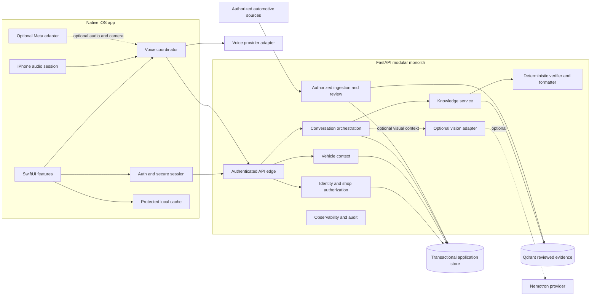
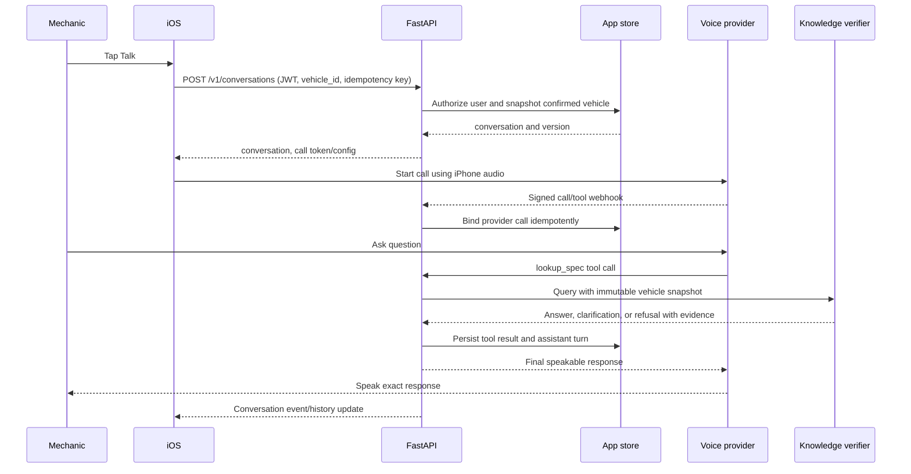
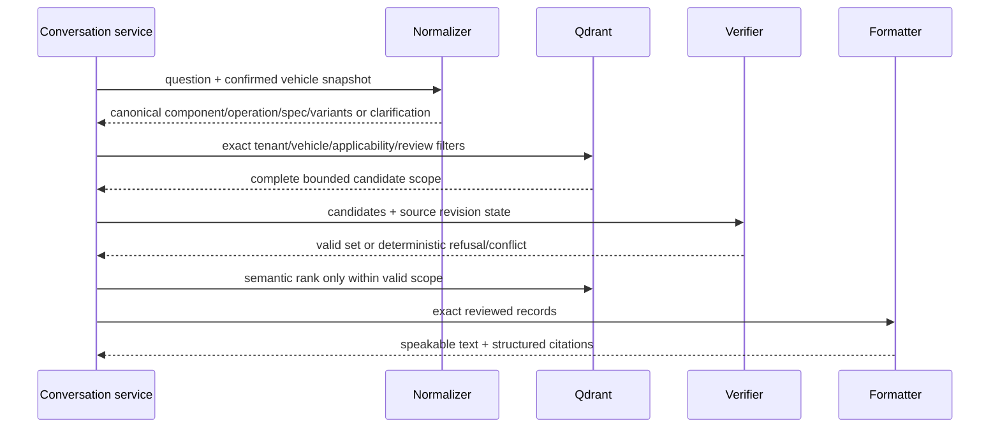

# Target architecture

## Decision summary

Build Carvis v1 as a **modular monolith**: one native iOS app, one FastAPI application, one transactional application data store, and Qdrant as a specialized reviewed-evidence index. Keep Vapi, Nemotron, Meta Wearables, Qdrant, and any automotive source behind adapters. Do not split services until measured scaling, isolation, or team-ownership needs justify it.

The exact transactional database and identity vendor require approval. The logical architecture does not depend on a vendor.

## Component architecture



Mandatory v1 paths are solid arrows through iPhone audio, authenticated API, durable conversation, verifier, and reviewed knowledge. Meta/vision/shop collaboration are optional provisions.

## Logical module boundaries

### iOS

- `AppShell`: navigation, dependency container, authenticated lifecycle.
- `OnboardingFeature`: sign-up/sign-in and consent; no direct persistence.
- `VehiclesFeature`: saved vehicles, default selection, confirmation and switching.
- `ConversationFeature`: phone-first audio UI, call state, transcript/citations/history.
- `HistoryFeature`: durable conversation summaries/details.
- `SettingsFeature`: account, privacy, audio route, diagnostics, sign-out/delete.
- `WearablesAdapter`: Meta registration/camera/speech isolated behind protocols.
- `APIClient`: authenticated versioned contracts, refresh/retry/idempotency.
- `LocalStore`: encrypted/protected cache, schema migrations, no authoritative specs.

### FastAPI modular monolith

- `identity`: JWT verification, users, shops, memberships and roles.
- `vehicles`: saved vehicles, applicability fields, active/confirmed context.
- `conversations`: conversations, calls, turns, tool executions, vehicle snapshots, idempotency.
- `knowledge`: query normalization, provider selection, source retrieval, coverage.
- `verification`: existing schema/retrieval/evidence/conflict/formatting core.
- `ingestion`: authorized jobs, extraction, review, revision and publication.
- `providers.voice`: Vapi webhooks and call configuration.
- `providers.vision`: Nemotron with non-authoritative output contract.
- `providers.automotive`: licensed data/manual adapters.
- `observability`: correlation IDs, metrics, redaction, audit events.

## Core sequences

### Start and continue an audio conversation



### Deterministic knowledge request



### Vehicle switching

1. User selects a saved vehicle.
2. Server verifies ownership/tenant and required applicability fields.
3. If a call is active, iOS ends it; an active call never mutates its vehicle snapshot.
4. Server creates a new conversation or increments context version, clears dependent component/operation/answer state, and marks vehicle unconfirmed.
5. At the next call start, Carvis states the selected vehicle and requires explicit confirmation.
6. Only then can technical lookup tools execute. Corrections create a new immutable snapshot and invalidate dependent results.

## Data model

| Entity | Essential fields / invariants | Owner |
| --- | --- | --- |
| `User` | id, identity subject, status, created/deleted timestamps | Identity module / app DB |
| `Shop` | id, name, status | Identity module / app DB |
| `Membership` | user_id, shop_id, role; unique active membership rule | Identity module / app DB |
| `Vehicle` | id, owner/shop, year/make/model, trim/engine/transmission/market/wheel size, optional VIN token/reference, revision | Vehicle module / app DB |
| `Conversation` | id, user/shop, vehicle_snapshot_id, status, version, started/ended, retention state | Conversation module / app DB |
| `VehicleSnapshot` | immutable normalized applicability copied at confirmation | Conversation module / app DB |
| `Call` | id, conversation, provider, provider_call_id, generation, status, idempotency key | Conversation module / app DB |
| `Turn` | id, conversation, role, text/redacted text, grounded flag, timestamps | Conversation module / app DB |
| `ToolExecution` | provider tool ID unique, input hash, status, exact output, evidence refs | Conversation module / app DB |
| `EvidenceRecord` | existing v2 `SpecRecord` payload and Qdrant point | Knowledge module / Qdrant |
| `SourceDocument` | hash, license/authority, revision, status, provenance metadata | Ingestion module / app DB |
| `ReviewDecision` | source/evidence digest, reviewer principal, timestamp, decision/reason | Ingestion module / app DB |
| `IngestionJob` | source, idempotency key, stage/status/error/cost metadata | Ingestion module / app DB |
| `AuditEvent` | actor, tenant, action, target, outcome, correlation ID; no secrets | Observability / append-oriented store |

Do not put authoritative user/conversation state in Qdrant. Do not put technical source evidence in a general chat transcript. Qdrant stores/searches evidence; the transactional store owns identity, workflow and audit.

## API contracts to introduce

All `/v1` endpoints require an end-user bearer token except signed provider webhooks and health endpoints. Tenant IDs are never accepted as authority from the client.

| Endpoint | Purpose | Key rules |
| --- | --- | --- |
| `GET /v1/me` | Account and memberships | Derived from verified token. |
| `GET/POST /v1/vehicles` | List/create saved vehicles | Normalize and validate required applicability. |
| `PATCH/DELETE /v1/vehicles/{id}` | Update/archive owned vehicle | Optimistic version; active snapshots immutable. |
| `POST /v1/conversations` | Create/resume with vehicle | Idempotency key; authorization; returns voice session config. |
| `POST /v1/conversations/{id}/vehicle-confirmations` | Confirm/correct context | Creates immutable snapshot/version; clears dependencies. |
| `GET /v1/conversations` | Paginated history | User/tenant scoped; retention-aware. |
| `GET /v1/conversations/{id}` | Turns, citations and status | Redacted and authorized. |
| `POST /v1/conversations/{id}/end` | Idempotent close | Safe retry. |
| `POST /v1/webhooks/vapi` | Signed provider events/tools | Required secret/signature, replay protection, provider call binding. |
| `POST /v1/admin/ingestion-jobs` | Authorized source staging | Reviewer/admin only; quotas; durable job. |
| `GET /v1/admin/ingestion-jobs/{id}` | Job status | No background-task ambiguity. |
| `POST /v1/admin/reviews` | Record source review | Named principal, source hash, evidence digest. |

Retain `/vapi-tool`, `/upload`, and `/vision-query` as compatibility adapters until consumers migrate. Add authentication without silently changing response semantics; version new contracts separately.

### Standard knowledge result

```json
{
  "status": "answered | clarification_required | refused",
  "speakable_text": "server-final text",
  "vehicle_snapshot_id": "...",
  "grounded": true,
  "citations": [
    {
      "source_document_id": "...",
      "revision": "...",
      "page": 12,
      "section": "...",
      "evidence_record_id": "..."
    }
  ],
  "reason_code": null
}
```

No raw proprietary source text should be returned beyond the licensed/necessary citation and answer contract.

## Trust boundaries

1. **iOS device:** user-controlled and untrusted; Keychain token proves identity, not request truth.
2. **Voice provider:** external processor; webhooks require signature/secret, timestamp/replay checks, and bound call IDs.
3. **FastAPI:** policy enforcement point; derives tenant and active vehicle snapshot.
4. **Automotive sources/reviewers:** only approved sources and named reviewers can make evidence answerable.
5. **Qdrant:** specialized index, not authorization authority; every payload is revalidated in Python.
6. **Vision provider:** supplies hypotheses only; cannot establish vehicle, spec, safety, part number, or procedure.
7. **Admin ingestion:** separate privilege and surface from mechanic queries.

## Failure strategy

- Identity unavailable: do not start a technical call; allow safe local retry/sign-out.
- Voice provider unavailable: retain conversation draft and offer typed question if approved; never fabricate response.
- Qdrant unavailable: return temporary-unavailable, persist failed tool outcome, no alternate-vehicle/source fallback.
- Evidence ambiguous/missing/stale: deterministic clarification/refusal with reason code.
- Durable store conflict: optimistic retry for idempotent commands; reject stale vehicle/context versions.
- Provider duplicate/replay: return the stored tool result by provider tool ID and input hash.
- App disconnect: call remains server-owned with timeout; reconnect reads authoritative status.
- Ingestion failure: job is failed/retryable; existing verified collection is untouched.
- Vision timeout: continue audio without visual context or explain unavailability; never block nonvisual lookup.

## Storage choice comparison

| Option | Fit | Risks | Recommendation |
| --- | --- | --- | --- |
| Managed relational DB plus standard OIDC/JWT | Natural for users, vehicles, conversations, audit, migrations and FastAPI transactions; broad tooling | New infrastructure and migrations; vendor selection | **Preferred baseline** if the priority is simplest conventional pilot operations. PostgreSQL is a candidate, not yet mandated. |
| SpacetimeDB as primary app store/identity | Existing role/shop work and real-time views; TypeScript module present | Current iOS/FastAPI identity integration is absent; dual runtime/toolchain; operational experience and durable workflow testing needed | Viable only after a time-boxed proof covering iOS auth, server attribution, migrations, backup/restore and local integration tests. |
| Qdrant for all state | Already deployed for evidence | Poor fit for transactional identity/conversation/audit; unsafe coupling | Reject. Keep Qdrant evidence-only. |
| Process memory/local JSON | Simple demo | Data loss, no scale/identity/audit | Reject for pilot authority; retain only caches/transient futures. |

Redis is not required for v1. Add it only if measured coordination/queue/cache needs cannot be met by the transactional store and process-local transient state.

## Migration path

1. Approve PRD, identity/data/store decisions and licensed pilot corpus.
2. Add new `/v1` modules and durable schema alongside existing routes; characterize old contracts with tests.
3. Add iOS auth and vehicle repository; migrate local profile as a one-time user-confirmed import.
4. Add phone-first voice provider adapter using durable conversation/call/tool records.
5. Route `lookup_spec` through the existing verifier unchanged; return structured citations.
6. Add history/settings and retention/deletion.
7. Run shadow/acceptance tests against a reviewed staging generation; do not change the Qdrant alias until the existing migration runbook gates pass.
8. Ship internal TestFlight, then mechanic pilot with restricted corpus/feature flags.
9. Isolate old demo navigation and optional glasses/vision. Remove compatibility paths only after telemetry and consumer audit prove no use.
